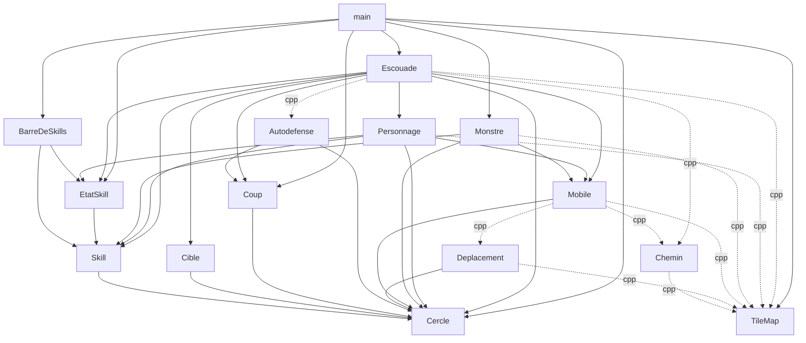

# Squad-ARPG — Audit du code avant l'étape 49

Audit en lecture seule, réalisé après l'étape 48 (commit `c45eca1`).
Aucun fichier existant n'a été modifié. Tous les constats décrivent le code
d'aujourd'hui ; aucune n'est une abstraction pour un besoin futur.

## Résumé

1. **`main()` fait tout** (258 lignes, non testée) : entrées, machine d'états
   de la visée, règles de jeu (qui obstrue qui, boucle monstre/escouade),
   dessin de l'aperçu, données du niveau (R1).
2. **`Escouade` est une classe-dieu** (640 lignes, 24 fonctions publiques,
   9 privées, 11 membres) : formation, combat, 4 types de skill, skill en
   attente, agresseurs, provocations (R2). `attaquer` (93 lignes) et
   `mettreAJour` (68) mélangent plusieurs niveaux de décision (R3).
3. **Points de vie et barre de vie dupliqués** entre `Personnage` et `Monstre`,
   ainsi que la recherche « monstre par identifiant » écrite 7 fois (D1, D3).
4. **`TileMap.hpp` inclut `<SFML/Graphics.hpp>`** en entier, `Coup.hpp` mélange
   entrée et sortie, `EtatSkill.hpp` inclut tout `Skill.hpp` pour un enum (P1, F2).
5. **Tests** : `test_Escouade.cpp` fait 2135 lignes (43 % des tests) ; la
   rotation de la formation et `main.cpp` ne sont pas testés ; helpers
   copiés dans 4 fichiers (T1–T3).

Bonne nouvelle : aucune règle d'architecture violée, 5 avertissements
seulement avec `-Wconversion`, 325 tests verts.

## Mesures

### Lignes par fichier

| Fichier | Lignes | | Fichier | Lignes |
|---|---|---|---|---|
| `tests/test_Escouade.cpp` | 2135 | | `src/Chemin.cpp` | 176 |
| `src/Escouade.cpp` | 640 | | `src/Personnage.cpp` | 192 |
| `tests/test_TileMap.cpp` | 552 | | `src/Monstre.cpp` | 142 |
| `tests/test_Monstre.cpp` | 431 | | `src/TileMap.cpp` | 150 |
| `tests/test_Personnage.cpp` | 362 | | `src/BarreDeSkills.cpp` | 124 |
| `tests/test_Chemin.cpp` | 294 | | `src/Escouade.hpp` | 91 |
| `src/main.cpp` | 276 | | `src/Mobile.cpp` | 89 |
| `tests/test_Mobile.cpp` | 207 | | autres `src/` | ≤ 59 chacun |
| `tests/test_Skill.cpp` | 188 | | `docs/historique.md` | 1240 |

Total `src/` : 2 357 lignes (26 fichiers) ; `tests/` : 4 583 lignes (ratio 1,9 : 1).

### Plus gros fichiers

| Élément | Mesure |
|---|---|
| `Escouade` | 24 fonctions publiques, 9 privées, 11 données membres, 2 structures publiques + 1 privée |
| `Escouade::attaquer` | 93 lignes (81–173) |
| `Escouade::mettreAJour` | 68 lignes |
| `Escouade::declencherSkill` | 67 lignes |
| `Escouade::choisirCible` | 53 lignes |
| `Escouade::avancerSkillEnAttente` | 44 lignes |
| `main.cpp` | une seule fonction, `main()`, 258 lignes ; boucle `while` de 183 lignes |
| `trouverChemin` | 85 lignes (A*, acceptable : un seul niveau de décision) |
| `TileMap::trajetLibre` | 62 lignes (balayage, bien commenté) |
| `Personnage` | 18 fonctions publiques, 0 privée ; `dessiner` 47 lignes |
| `Monstre` | 11 publiques, 1 privée |

### Avertissements (`-Wall -Wextra -Wpedantic -Wshadow -Wconversion`)

5 avertissements, tous `-Wconversion` (`int` → `float`) dans `src/TileMap.cpp`
(lignes 50, 60, 109 : `x * m_tailleCase`, `(coordCase.x + 0.5f)`,
`colonne * m_tailleCase`). Rien dans les autres fichiers, rien dans les
tests, aucun `-Wshadow`, `-Wextra` ni `-Wpedantic`. Dossier de build
temporaire supprimé ; `./build/tests.exe` : 325 tests, 967 assertions, tous
passent ; `git status` propre avant l'ajout de ce fichier.

## Graphe des dépendances (inclusions de `src/`)



Traits pleins = `.hpp`, pointillés = `.cpp` seulement. Pas de cycle.
`TileMap` n'inclut aucun module du projet (seulement SFML).

**Vérification des règles** : `Escouade` ne connaît pas `Monstre` (elle voit
`MonstreVu`) ✔ ; `Skill` ne connaît pas `TileMap` ✔ ; `Mobile` ne connaît ni
`Escouade`, `Personnage`, `Monstre` ni `Skill` ✔ ; `Personnage` ne connaît pas
`Escouade` ni `Monstre` ✔ ; `Monstre` ne connaît ni `Escouade` ni `Personnage`
✔ ; `BarreDeSkills` ne connaît ni `Escouade` ni `Personnage` ✔ ; `main.cpp` ne
nomme jamais `Personnage` ni `Chemin` ✔ (il inclut seulement `Escouade.hpp`, qui
inclut `Personnage.hpp` ; voir P2). **Aucune règle violée.**
Écarts mineurs entre documentation et code : voir F4.

---

## R — Responsabilités

### R1 — `main()` concentre entrées, règles de jeu, données et dessin
- **Constat** : `main()` (258 lignes, une seule fonction, aucun test) mélange
  cinq rôles : créer la fenêtre et charger la police ; définir le niveau (plan
  de 40 lignes, positions des 6 monstres) ; interpréter les entrées (clic,
  touches 1–4, Échap, clic droit) avec la machine d'états de la visée
  (`placeEnVisee`, `deplacementContinu`, `placeSkillDemandee`, `pointDeLancer`) ;
  appliquer des règles de jeu (liste d'obstacles des personnages et des
  monstres, boucle « proie → mise à jour → frappe → `recevoirDegats` », retrait
  des morts, déverrouillage si la cible meurt) ; dessiner (aperçu de visée).
  La logique de visée et d'intermédiaire monstres/escouade ne peut pas être
  testée.
- **Où** : `src/main.cpp`, tout.
- **Gravité** : haute (chaque étape y ajoute des lignes ; les règles ne sont pas testables).
- **Proposition** : extraire dans `squad_core`, sans changer le comportement,
  (a) la boucle monstre/escouade (construire `MonstreVu`, obstacles, appliquer
  les `Coup`, tour de chaque monstre) en fonctions libres ou en une petite
  classe, et (b) l'état de visée (`placeEnVisee`, validité, annulation) en un
  type testable. Laisser dans `main()` la fenêtre, les événements SFML et le
  dessin. Le plan et les positions des monstres peuvent rester dans `main.cpp`
  (voir F3).
- **Coût** : moyen.
- **Risque et tests touchés** : moyen (ordre des appels dans la boucle à
  conserver exactement : zone → skill → `attaquer` → retrait → déplacement
  continu → mise à jour). Aucun test existant touché ; des nouveaux tests
  deviennent possibles. Vérification visuelle nécessaire.
- **Dépend de** : D3 (la recherche par identifiant) simplifie l'extraction.

### R2 — `Escouade` porte six responsabilités
- **Traité à l'étape 51** : (a) `Provocations` et (b) `Agresseurs` sont extraits.
  (c), la formation, n'est **pas** traitée.
- **Constat** : `Escouade` fait (1) la formation et l'orientation (ancre,
  décalages, rotation, `m_places`, repli) ; (2) le verrou de combat et
  l'approche ; (3) la création et la résolution de quatre types de skill
  (dégâts, soin, provocation, zone) ; (4) le skill en attente ; (5) la mémoire
  des agresseurs ; (6) les provocations et le choix de la proie d'un monstre.
  Ces blocs ne partagent presque pas de données : `m_agresseurs` et
  `m_provocations` ne sont lus que par 4–5 fonctions chacun. Chaque nouvelle
  étape de skill ou de combat ajoute des membres et des fonctions publiques.
- **Où** : `Escouade.hpp` / `Escouade.cpp`.
- **Gravité** : haute.
- **Proposition** : extraire en types possédés par valeur par `Escouade`
  (jamais d'héritage) les blocs les plus indépendants : (a) un petit type
  `Provocations` (liste + `provoquer`, `tick`, `proie`, `getProvocations`) ; (b)
  un petit type `Agresseurs` (liste + enregistrer, oublier, `tick`, mise à
  jour des cercles) ; (c) éventuellement la formation (décalages, orientation,
  rotation, places). `Escouade` garde l'orchestration et son interface
  publique inchangée, donc `main.cpp` et les tests d'`Escouade` ne changent pas.
- **Coût** : gros si on fait (a)(b)(c) ; moyen pour (a)+(b) seulement
  (recommandé : ce sont les plus nets).
- **Risque et tests touchés** : faible si l'interface publique ne bouge pas ;
  les 139 tests d'`Escouade` servent de filet. Les tests d'agresseurs (§1148–
  1300) et de provocation (§1307–1420) pourraient ensuite migrer vers les
  nouveaux types (voir T1).
- **Dépend de** : aucun (R3 et D2 sont plus faciles après).

### R3 — `attaquer`, `mettreAJour` et `declencherSkill` mélangent plusieurs niveaux
- **Traité à l'étape 51** pour `attaquer` (88 → 14 lignes) et `mettreAJour`
  (68 → 19 lignes, `pointVoulu`). `declencherSkill` n'est pas touchée.
- **Constat** : `attaquer` (93 lignes) fait successivement : maintenance des
  agresseurs, maintenance des provocations, départ du skill de zone en attente,
  approche du verrou (calcul de `tousAtteignent`, ordre d'arrêt/marche), départ
  du skill de dégâts en attente, puis l'autodéfense de chaque personnage.
  `mettreAJour` (68 lignes) enchaîne péremptions, ancre, rotation, puis choisit
  le point voulu de chaque personnage avec quatre priorités successives
  (place, agresseur, combat, skill) écrasées l'une par l'autre. `declencherSkill`
  (67 lignes) dispatche par type avec des `if` en cascade.
- **Où** : `Escouade::attaquer`, `Escouade::mettreAJour`, `Escouade::declencherSkill`.
- **Gravité** : moyenne (lisible aujourd'hui grâce aux commentaires, mais la
  prochaine règle de priorité s'y ajoutera).
- **Proposition** : découper en sous-fonctions privées nommées, sans changer
  l'ordre : `oublierMonstresAbsents(monstres)`, `departSkillZoneEnAttente`,
  `approcherVerrou`, `autodefense`, et dans `mettreAJour` une fonction
  `pointVoulu(i, ...)` qui rend la priorité explicite (une seule place où lire
  « le skill gagne sur le combat, qui gagne sur l'agresseur, qui gagne sur la place »).
- **Coût** : petit à moyen (refactorisation pure).
- **Risque et tests touchés** : faible ; aucun test modifié.
- **Dépend de** : mieux après R2.

### R4 — `Skill` sert à des usages qui ne partagent que « une recharge »
- **Constat** : `Skill::declencher(origine, cible)` vérifie la portée, mais
  pour la provocation et la zone, `Escouade` passe `lanceur.getCercle()` comme
  cible (« le lanceur est sa propre cible »), une astuce pour contourner la
  vérification de portée. La même `puissance` signifie dégâts, soin, secondes
  (convertie `int` → `float` par `static_cast` dans `declencherSkill`) ou dégâts
  de zone ; `rayonZone` n'est lu que pour deux types sur quatre.
- **Où** : `Skill.hpp/.cpp`, `Escouade::declencherSkill` (provocation),
  `Escouade::lancerSkillDeZone`.
- **Gravité** : basse (documenté dans `Skill.hpp`, accepté à l'étape 45).
- **Proposition** : ajouter à `Skill` un `declencherSansCible()`
  (recharge + puissance, sans portée) pour la provocation et la zone, afin de
  supprimer l'astuce du cercle du lanceur. Ne pas toucher au reste.
- **Coût** : petit.
- **Risque et tests touchés** : faible ; `test_Skill.cpp` à compléter.
- **Dépend de** : aucun.

**Écarté à l'étape 49** : hors de portée de la refactorisation d'hygiène ; l'astuce du cercle du lanceur reste documentée dans `Skill.hpp` et `docs/combat.md`.

---

## D — Duplication

### D1 — Points de vie et barre de vie, copiés entre `Personnage` et `Monstre`
- **Constat** : `m_pointsDeVie`, `m_pointsDeVieMax`, `recevoirDegats` (même
  borne à 0), `estVivant`, et le dessin de la barre de vie (fond gris
  `Color(60,60,60)`, hauteur 5, écart 6, vert, `ratio = pv / pvMax`) existent
  deux fois. Déjà dans la liste « pistes » du ROADMAP.
  ```cpp
  const float ratio = static_cast<float>(m_pointsDeVie) / static_cast<float>(m_pointsDeVieMax);
  sf::RectangleShape vie({taille.x * ratio, hauteurBarre});
  ```
  Même code dans `Personnage::dessiner` et `Monstre::dessiner`. Une division par
  zéro est possible si `m_pointsDeVieMax` valait 0 (impossible aujourd'hui).
- **Où** : `Personnage.cpp` (l. 20–60, 121–140), `Monstre.cpp` (l. 14–40, 62–65).
- **Gravité** : moyenne (la prochaine modification de la barre — couleur,
  position, effet de coup — devra être faite deux fois).
- **Proposition** : une petite fonction libre de dessin
  `dessinerBarreDeVie(rendu, centre, largeur, ratio)` dans un `.cpp` à part
  (point de départ minimal, sans classe). L'extraction de la logique de points de
  vie en un type `PointsDeVie` peut suivre, seulement si le besoin se confirme.
- **Coût** : petit (fonction de dessin) ; moyen (type `PointsDeVie`).
- **Risque et tests touchés** : faible ; le dessin n'est pas testé ; les tests
  de `recevoirDegats`/`recevoirSoin` ne changent pas.
- **Dépend de** : aucun.

**Traité à l'étape 49.**

### D2 — Validation de la place (1 à 4) répétée
- **Constat** : `place < 1 || place > m_personnages.size()` apparaît 5 fois
  dans `Escouade.cpp` (`declencherSkill`, `etatDuSkill`, `rayonZoneDuSkill`,
  `cercleDePorteeDuSkill`, `choisirCible`), plus `skillEstPret` ; et le
  `m_personnages[place - 1]` figure ~25 fois. Un oubli de validation ferait un
  accès hors bornes (comportement indéfini). Dans `declencherSkillDeZone` et
  `lancerSkillDeZone`, l'accès se fait sans revalidation, en s'appuyant sur
  `skillEstPret(place)`.
- **Où** : `Escouade.cpp`.
- **Gravité** : moyenne (cache un risque de bogue à chaque nouvelle fonction par place).
- **Proposition** : deux fonctions privées, `bool placeValide(std::size_t) const`
  et `Personnage& personnageDeLaPlace(std::size_t)` (+ `const`), qui centralisent
  la conversion « place 1–4 » → indice 0–3.
- **Coût** : petit.
- **Risque et tests touchés** : faible ; les tests « place invalide » existants
  servent de filet.
- **Dépend de** : aucun (à faire avant R2/R3).

**Traité à l'étape 49.**

### D3 — « Trouver un monstre par identifiant » écrit 7 fois
- **Constat** : le même `std::find_if(... m.id == x)` apparaît dans
  `Escouade::attaquer` (3 fois, + 2 pour agresseurs/provocations),
  `Escouade::choisirCible` (2 fois) et dans `main.cpp` (3 fois : clic,
  verrouillé, `appliquer`). Dans `main.cpp`, `touche->recevoirDegats` déréférence
  l'itérateur sans vérifier `end()`.
  ```cpp
  const auto cible = std::find_if(monstres.begin(), monstres.end(),
      [&](const MonstreVu& m) { return m.id == *id; });
  ```
- **Où** : `Escouade.cpp` (l. 86–97, 117, 164, 576, 596), `main.cpp` (l. 119, 159, 173).
- **Gravité** : moyenne.
- **Proposition** : une fonction libre
  `const MonstreVu* trouverMonstre(const std::vector<MonstreVu>&, int id)` (dans
  `Autodefense` ou près de `MonstreVu`) pour `Escouade`, et un petit utilitaire
  équivalent dans `main.cpp` (ou dans l'extraction de R1) pour `Monstre`.
- **Coût** : petit.
- **Risque et tests touchés** : faible ; aucun test modifié.
- **Dépend de** : aucun.

**Traité à l'étape 49.**

### D4 — Valeurs magiques et constantes dispersées
- **Constat** : (a) taille 20 × 20 écrite dans `Escouade::Escouade` (ancre),
  deux fois dans `Personnage::Personnage` (`m_mobile` ET `m_taille`), rayon 10
  déduit ; monstre 30 × 30 et 15 ailleurs ; (b) l'attaque de base
  `Skill(TypeSkill::Degats, portée, 5, 0.5f, 0.0f)` est écrite 4 fois dans le
  constructeur d'`Escouade`, les 5 et 0.5f en dur ; (c) vitesses 180, 240, 120,
  rotation 360, 100 points de vie (2 fois) en dur dans les initialiseurs ; (d)
  constantes nommées avec trois styles différents : `s_xxx` (Escouade.cpp,
  Personnage.cpp, BarreDeSkills.cpp), `COTE_LIGNE_DE_VUE` (TileMap.cpp), et
  littéraux locaux (`hauteurBarre = 5.0f` redéclaré dans deux `dessiner`) ; (e)
  `s_porteeZone` porte le commentaire périmé « pas encore lue » alors que la
  portée est lue depuis l'étape 43 ; (f) le commentaire de `Monstre` sur
  l'« ancienne portée (40) » ne sert plus.
- **Où** : `Escouade.cpp` (l. 14–33, 35–59), `Personnage.cpp`, `Monstre.cpp`,
  `TileMap.cpp`, `BarreDeSkills.cpp`.
- **Gravité** : basse à moyenne (surtout (a) : `Personnage::m_taille` double
  `m_mobile.getTaille()`, et peut diverger).
- **Proposition** : supprimer `Personnage::m_taille` (lire `m_mobile.getTaille()`
  comme `Monstre`) ; nommer l'attaque de base de mêlée et de tireur (une
  constante ou une fonction qui construit le `Skill`) ; uniformiser le style de
  nommage des constantes (choisir un style et l'écrire dans CLAUDE.md) ;
  corriger les deux commentaires périmés.
- **Coût** : petit.
- **Risque et tests touchés** : faible ; `m_taille` n'est pas testé directement.
- **Dépend de** : aucun.

**Traité à l'étape 49** (a à f).

### D5 — Deux types presque identiques : `Escouade::Agresseur` et `MonstreVu`
- **Traité à l'étape 51** : `Agresseur` contient un `MonstreVu`, et la liste de
  `MonstreVu` est construite une fois par image.
- **Constat** : `pointVersAgresseur` reconstruit, à chaque appel (donc 4 fois par
  image), un `std::vector<MonstreVu>` à partir de `m_agresseurs` pour appeler
  `choisirAgresseurAViser`. `Agresseur{id, cercle, tempsRestant}` contient
  exactement un `MonstreVu` plus un temps.
- **Où** : `Escouade::pointVersAgresseur`, `Autodefense.hpp`, `Escouade.hpp`.
- **Gravité** : basse.
- **Proposition** : soit construire la liste une fois par `mettreAJour`, soit
  faire contenir un `MonstreVu` à `Agresseur` (`MonstreVu vu; float tempsRestant;`).
- **Coût** : petit.
- **Risque et tests touchés** : faible ; tests d'agresseurs lisent `.id`,
  `.cercle`, `.tempsRestant` (à adapter si on choisit la composition).
- **Dépend de** : R2 (si les agresseurs sont extraits, le faire en même temps).

### D6 — Doublons dans la logique « annuler le skill de dégâts en attente »
- **Constat** : `verrouiller` et `deverrouiller` répètent le test
  `m_skillEnAttente.has_value() && holds_alternative<CibleMonstre>(...)` suivi de
  `m_skillEnAttente = std::nullopt`. Le test « le skill en attente est de dégâts »
  est aussi dans `attaquer` et `avancerSkillEnAttente`.
- **Où** : `Escouade.cpp` (l. 141, 344, 624–636).
- **Gravité** : basse.
- **Proposition** : une fonction privée `annulerSkillDeDegatsEnAttente()` et
  une `skillEnAttenteDeDegats() const`.
- **Coût** : petit.
- **Risque et tests touchés** : faible.
- **Dépend de** : aucun.

**Traité à l'étape 49.**

---

## P — Dépendances

### P1 — `TileMap.hpp` inclut toute l'API graphique de SFML
- **Constat** : `TileMap.hpp` fait `#include <SFML/Graphics.hpp>`, le parapluie
  complet, alors qu'il n'utilise que `sf::Vector2`, `sf::FloatRect` et
  `sf::RenderTarget`. Comme `TileMap.hpp` est inclus par presque tous les `.cpp`
  de `squad_core` et par tous les tests, chaque compilation tire toute la
  bibliothèque. La règle « chaque fichier inclut les en-têtes précis des types
  qu'il utilise » de CLAUDE.md n'est pas respectée ici (les `.hpp` des autres
  modules incluent des en-têtes précis). `TileMap.cpp` utilise `sf::RectangleShape`
  et `sf::Color` sans les inclure (il en dépend via le parapluie).
- **Où** : `src/TileMap.hpp`, `src/TileMap.cpp`.
- **Gravité** : moyenne (temps de compilation ; fragilité des inclusions indirectes).
- **Proposition** : remplacer par `<SFML/Graphics/Rect.hpp>`,
  `<SFML/Graphics/RenderTarget.hpp>`, `<SFML/System/Vector2.hpp>` dans le `.hpp`,
  et ajouter `RectangleShape.hpp` et `Color.hpp` dans le `.cpp` ; corriger ensuite
  les `.cpp`/tests qui comptaient sur l'inclusion indirecte (le compilateur les
  signalera).
- **Coût** : petit.
- **Risque et tests touchés** : faible ; peut obliger à ajouter des `#include`
  dans quelques tests.
- **Dépend de** : aucun.

**Traité à l'étape 49.**

### P2 — `Escouade.hpp` expose `Personnage.hpp` et `Skill.hpp` à `main.cpp`
- **Constat** : `main.cpp` « ne connaît pas `Personnage` », mais il l'inclut
  transitivement par `Escouade.hpp` (qui en a besoin pour `std::vector<Personnage>`,
  membre par valeur) ; `Skill.hpp` est inclus pour `TypeSkill` seul (paramètre de
  `choisirCible`). C'est seulement un problème de couplage de compilation :
  aucune règle n'est violée dans le code de `main.cpp`.
- **Où** : `src/Escouade.hpp`.
- **Gravité** : basse.
- **Proposition** : ne rien changer maintenant ; si R2 sort les blocs d'`Escouade`,
  vérifier ensuite que les inclusions de l'en-tête sont toutes nécessaires.
  `TypeSkill` seul pourrait aller dans `TypeSkill.hpp` (voir F2).
- **Coût** : petit.
- **Risque et tests touchés** : aucun.
- **Dépend de** : R2, F2.

### P3 — Petits écarts d'inclusion
- **Constat** : `Autodefense.hpp` inclut `Coup.hpp` pour `MonstreVu` mais n'utilise
  pas `Coup` ; `BarreDeSkills.hpp` inclut `Skill.hpp` en plus d'`EtatSkill.hpp` (qui
  l'inclut déjà) ; `Escouade.cpp` inclut `<SFML/Graphics/Color.hpp>` après
  `RectangleShape.hpp` (ordre incohérent avec les autres fichiers) ; `Chemin.cpp`
  mentionne dans un commentaire « Escouade::mettreAJour » alors que le déplacement
  vit dans `Mobile` depuis l'étape 23.
- **Où** : fichiers cités.
- **Gravité** : basse.
- **Proposition** : une passe de nettoyage ; voir F2 pour `MonstreVu`/`Coup`.
- **Coût** : petit.
- **Risque et tests touchés** : aucun.
- **Dépend de** : F2.

**Traité à l'étape 49.**

---

## F — Fichiers et organisation

### F1 — `src/` à plat : 26 fichiers en 4 familles
- **Constat** : `src/` contient 26 fichiers à plat. Quatre familles apparaissent :
  *monde et déplacement* (`TileMap`, `Chemin`, `Deplacement`, `Mobile`), *combat*
  (`Skill`, `Cercle`, `Cible`, `Coup`, `Autodefense`, `EtatSkill`), *entités*
  (`Escouade`, `Personnage`, `Monstre`), plus l'interface (`BarreDeSkills`). Lisible
  aujourd'hui, moins avec 40 fichiers ou plus.
- **Où** : `src/`, `CMakeLists.txt` (liste des sources), tous les `#include`.
- **Gravité** : basse (cosmétique à ce stade).
- **Proposition** : ne pas déplacer maintenant. Si le dossier dépasse ~40 fichiers,
  créer `src/monde/`, `src/combat/`, `src/entites/` en un seul commit « déplacement
  pur » (règle 6 de CLAUDE.md), `target_include_directories` restant sur `src`
  (les includes deviendraient `"combat/Skill.hpp"`).
- **Coût** : moyen (déplacement + includes + docs).
- **Risque et tests touchés** : faible mais touche tous les fichiers ; les tests
  changent seulement leurs `#include`.
- **Dépend de** : P1, F2, R2 (faire d'abord les extractions, déplacer ensuite).

**Écarté à l'étape 49** : `src/` compte 31 fichiers, sous le seuil d'environ 40 fixé par le constat ; pas de déplacement maintenant.

### F2 — En-têtes « fourre-tout »
- **Constat** : (a) `Coup.hpp` contient deux types de sens opposé : `MonstreVu`
  (entrée d'`Escouade`, aussi lu par `Autodefense`) et `Coup` (sortie) ; (b)
  `EtatSkill.hpp` inclut tout `Skill.hpp` pour `TypeSkill` seul, comme `BarreDeSkills.hpp` ;
  (c) `Cible.hpp` est cohérent. `TypeSkill` vit dans `Skill.hpp`, ce qui force les
  modules d'affichage et de décision à dépendre de la classe `Skill` complète.
- **Où** : `Coup.hpp`, `EtatSkill.hpp`, `BarreDeSkills.hpp`, `Skill.hpp`.
- **Gravité** : basse.
- **Proposition** : séparer `MonstreVu` dans `MonstreVu.hpp` (ou le garder avec
  `Coup` mais en connaissance de cause) ; sortir `enum class TypeSkill` dans
  `TypeSkill.hpp`. Chaque changement est un déplacement pur.
- **Coût** : petit.
- **Risque et tests touchés** : faible ; adapter les `#include` des tests.
- **Dépend de** : aucun.

**Traité à l'étape 49.**

### F3 — Frontière `squad_core` / exécutable
- **Constat** : (a) de la **logique** vit dans l'exécutable : voir R1 (boucle monstre/
  escouade, état de visée, composition des obstacles) ; (b) des **données de niveau**
  (plan de la carte, positions des monstres) sont codées en dur dans `main()` ;
  (c) de l'**affichage** vit dans `squad_core` : `dessiner` de `TileMap`,
  `Escouade`, `Personnage`, `Monstre`, et `BarreDeSkills`, ce qui oblige les tests à
  lier SFML Graphics. C'est un choix assumé (ARCHITECTURE.md), pas une anomalie ;
  l'aperçu de la visée (deux `sf::CircleShape`) est en revanche dessiné dans
  `main.cpp` alors que tout le reste du dessin passe par un `dessiner`.
- **Où** : `main.cpp` (l. 32–84, 245–265), `CMakeLists.txt`.
- **Gravité** : moyenne pour (a), basse pour (b) et (c).
- **Proposition** : traiter (a) par R1 ; mettre l'aperçu de visée dans une fonction
  libre `dessinerApercuDeVisee` (à côté de `BarreDeSkills`, par exemple) ; garder (b)
  tant qu'il n'y a qu'un niveau (ne pas créer de chargeur de fichiers : anticipation).
- **Coût** : petit pour l'aperçu.
- **Risque et tests touchés** : faible ; dessin non testé.
- **Dépend de** : R1.

### F4 — Documentation en retard sur le code
- **Constat** : ARCHITECTURE.md décrit `Personnage::estAPortee` avec « `m_attaque` »
  et `frapper` avec « `m_attaque.frapper` », ainsi que `declencherSkill` avec
  « `m_attaque` », alors que le membre s'appelle `m_attaqueDeBase` (fusion de
  l'étape 45). `Personnage::m_taille` y est listé alors qu'il double `Mobile` (D4).
  `docs/historique.md` fait 1 240 lignes (non relu en séance : jamais nécessaire).
- **Où** : `ARCHITECTURE.md`, sections `Personnage`.
- **Gravité** : basse.
- **Proposition** : corriger lors de la prochaine documentation d'étape.
- **Coût** : petit.
- **Risque et tests touchés** : aucun.
- **Dépend de** : D4 (si `m_taille` disparaît).

**Traité à l'étape 49.**

### F5 — `CMakeLists.txt` : listes de sources sur une seule ligne
- **Constat** : `add_library(squad_core ...)` et `add_executable(tests ...)` listent
  11 fichiers sur une ligne chacun ; chaque ajout oblige à éditer une ligne de plus
  de 200 caractères (diffs illisibles). Pas d'option d'avertissements dans le
  projet (les avertissements ne sont jamais vus en build normal).
- **Où** : `CMakeLists.txt`.
- **Gravité** : basse.
- **Proposition** : une source par ligne ; ajouter les avertissements (`-Wall
  -Wextra -Wpedantic -Wshadow -Wconversion`) à `squad_core`, après avoir corrigé
  les 5 avertissements de `TileMap.cpp` (voir C1). Pas de changement d'outil de build.
- **Coût** : petit.
- **Risque et tests touchés** : aucun test ; le build ne doit plus afficher
  d'avertissement.
- **Dépend de** : C1.

**Traité à l'étape 49.**

---

## C — Qualité C++

### C1 — Cinq conversions `int` → `float` dans `TileMap.cpp`
- **Constat** : seuls avertissements du projet avec `-Wconversion` :
  `x * m_tailleCase` (l. 50, 60), `(coordCase.x + 0.5f)` (l. 60) et
  `colonne * m_tailleCase` (l. 109). Inoffensifs aujourd'hui (cartes petites).
- **Où** : `TileMap.cpp` l. 50, 60, 109.
- **Gravité** : basse.
- **Proposition** : `static_cast<float>(...)` explicite.
- **Coût** : petit.
- **Risque et tests touchés** : aucun (arithmétique identique).
- **Dépend de** : aucun.

**Traité à l'étape 49.**

### C2 — `Cible` lue avec `holds_alternative` / `get_if` / `get`, jamais `std::visit`
- **Constat** : `avancerSkillEnAttente` teste `holds_alternative<CibleMonstre>`,
  puis `get_if<CiblePoint>`, puis suppose le reste en `std::get<CibleAllie>` : si une
  4ᵉ alternative était ajoutée à `Cible`, ce code ne signalerait rien à la
  compilation et lèverait `bad_variant_access` à l'exécution. Même motif dans
  `declencherSkill` (`get_if<CibleMonstre>`, puis `get_if<CibleAllie>` avec un cas
  `nullptr` jamais atteint) et `attaquer`. Le seul `switch` du code (`lettreDuSkill`)
  est correct : pas de `default`, `return '?'` après le switch.
- **Où** : `Escouade::avancerSkillEnAttente`, `declencherSkill`, `attaquer`,
  `verrouiller`, `deverrouiller`.
- **Gravité** : moyenne (le prochain type de cible cassera silencieusement).
- **Proposition** : `std::visit` avec un ensemble de lambdas (ou un `struct` de
  surcharges) dans `avancerSkillEnAttente`, pour que le compilateur exige le
  traitement de chaque alternative. Garder `holds_alternative` pour les simples
  tests booléens (D6).
- **Coût** : petit.
- **Risque et tests touchés** : faible ; tests de skill en attente.
- **Dépend de** : D6.

**Traité à l'étape 49.**

### C3 — `[[nodiscard]]` et `explicit`
- **Constat** : aucun `[[nodiscard]]` dans le projet. Des retours dont l'oubli est un
  bogue : `Escouade::attaquer`/`declencherSkill`/`declencherSkillDeZone` (liste de
  `Coup` à appliquer), `Monstre::frapper`, `Personnage::frapper`,
  `Personnage::declencherSkill`, `Skill::declencher`, `trouverChemin`, `choisir*`.
  Les constructeurs à un paramètre (`Escouade`) sont bien `explicit`.
- **Où** : fonctions citées.
- **Gravité** : moyenne pour les `Coup` (si `main.cpp` oublie `appliquer`, le skill
  est lancé sans effet, sans aucun signal).
- **Proposition** : `[[nodiscard]]` sur ces fonctions ; les tests qui ignorent un
  retour volontairement (`(void)` ou stockage dans une variable) seront signalés.
- **Coût** : petit.
- **Risque et tests touchés** : faible ; quelques tests à adapter.
- **Dépend de** : aucun.

**Traité à l'étape 49.**

### C4 — Passage par valeur / référence et `const`
- **Constat** : globalement conforme à CLAUDE.md. Points à relever : `Cercle`
  (12 octets) est passé par valeur dans `Personnage`/`Skill`/`Autodefense` mais par
  `const Cercle&` dans `Cercle.hpp` et `Deplacement.hpp` (deux conventions pour le
  même type) ; `Personnage` copie ses deux `Skill` à la construction (copies, pas de
  `std::move`, négligeable) ; `Monstre::mettreAJour` prend `std::optional<Cercle>` par
  valeur (correct) ; `std::function<bool(Cercle)>` dans `choisirMonstreAFrapper` (coût
  d'indirection par appel, négligeable ici) ; `pointVersAgresseur` alloue un vecteur
  par personnage et par image (D5).
- **Où** : `Cercle.hpp`, `Deplacement.hpp`, `Personnage.cpp`, `Autodefense.hpp`.
- **Gravité** : basse.
- **Proposition** : choisir une convention pour `Cercle` (par valeur, comme la majorité
  du code) et l'écrire dans CLAUDE.md.
- **Coût** : petit.
- **Risque et tests touchés** : aucun.
- **Dépend de** : aucun.

**Traité à l'étape 49.**

### C5 — Divers
- **Constat** : (a) `Personnage::dessiner`, `Monstre::dessiner` et `TileMap::dessiner`
  créent des `sf::RectangleShape` à chaque image (conforme à CLAUDE.md : « les formes
  sont créées dans `dessiner` ») ; (b) `Escouade::m_monstreAPortee` est un
  `std::vector<bool>` (spécialisation particulière, sans `data()`), calculé par
  `attaquer` et lu par `mettreAJour` : un couplage temporel implicite entre deux
  fonctions ; (c) `Escouade::m_cibleCombat` est de même mis à jour par `attaquer` et lu
  par `mettreAJour`/`avancerSkillEnAttente` ; (d) `Escouade::attaquer` déréférence
  `find_if(...)->cercle` sans test `end()` (correct par construction, mais nécessite
  de relire les 10 lignes précédentes) ; (e) le dessin de l'ancre (`Escouade::dessiner`)
  utilise `getCentre() - taille / 2` plutôt qu'un accesseur de rectangle.
- **Où** : `Escouade.cpp`, `Escouade.hpp`.
- **Gravité** : basse (b, c : moyenne si `attaquer`/`mettreAJour` changent d'ordre dans `main.cpp`).
- **Proposition** : documenter l'ordre d'appel obligatoire (`attaquer` avant `mettreAJour`)
  dans `Escouade.hpp` ; changer `vector<bool>` en `std::array<bool, 4>` ou `std::vector<char>` ;
  éviter les déréférencements non vérifiés par une fonction `trouverMonstre` (D3).
- **Coût** : petit.
- **Risque et tests touchés** : faible.
- **Dépend de** : D3.

**Traité à l'étape 49** (b, c, d). Le dessin à chaque image (a) et l'ancre (e) sont conformes aux conventions et restent tels quels.

---

## T — Tests

### T1 — `test_Escouade.cpp` : 2135 lignes, 139 tests, un seul fichier
- **Constat** : 43 % des lignes de test sont dans un seul fichier qui couvre
  déplacement, combat, skills (4 types), soin, agresseurs, provocation, zone, ligne de
  vue, `etatDuSkill`. La navigation se fait au numéro de ligne ; le temps de
  compilation de ce fichier domine celui de `tests`. Aucun `SECTION` Catch2 nulle
  part : chaque cas répète son préambule.
- **Où** : `tests/test_Escouade.cpp`.
- **Gravité** : moyenne (gêne déjà la lecture ; bloque le test unitaire des futurs
  types extraits de R2).
- **Proposition** : couper par thème en `test_Escouade_deplacement.cpp`,
  `test_Escouade_combat.cpp`, `test_Escouade_skills.cpp`,
  `test_Escouade_agresseurs.cpp` (agresseurs + provocations), `test_Escouade_vue.cpp`
  (étape 46) ; déplacement pur des tests, sans modification. Un fichier d'aide commun
  (voir T2).
- **Coût** : petit à moyen (déplacement + `CMakeLists.txt`).
- **Risque et tests touchés** : faible (nombre de tests inchangé : 325, vérifié par `tests.exe`).
- **Dépend de** : T2 (les helpers doivent être partagés avant de couper).

**Traité à l'étape 50.** Cinq fichiers (`deplacement`, `combat`, `skills`,
`agresseurs`, `vue`) ; le plus gros, `skills`, fait 786 lignes.

### T2 — Helpers de test copiés d'un fichier à l'autre
- **Constat** : `verifierPointProche` est copiée dans 3 fichiers (`test_Escouade`,
  `test_Mobile`, `test_Monstre`) ; `carteDegagee()` dans 4 (et `carteDegageeSoin` dans
  `test_Escouade`, soit 5 variantes de cartes vides) ; `pointCible` dans 3 ;
  `ecoulerTemps` dans 3 avec des signatures différentes. `test_Escouade.cpp` mélange
  aussi `static` et `namespace {}` pour ses helpers.
- **Où** : `tests/test_*.cpp`.
- **Gravité** : moyenne.
- **Proposition** : un `tests/aides.hpp` (en-tête seul, `inline`) avec les helpers
  vraiment identiques ; ajouter l'aide à `target_include_directories` de `tests`
  (modification de `CMakeLists.txt`).
- **Coût** : petit.
- **Risque et tests touchés** : faible.
- **Dépend de** : aucun.

**Traité à l'étape 50.** `tests/aides.hpp` ; `ecoulerTemps` reste local
(trois signatures différentes). Pas de modification de `CMakeLists.txt` :
`#include "aides.hpp"` se résout depuis le dossier du `.cpp`.

### T3 — Zones non couvertes
- **Constat** : (a) **la rotation progressive de la formation** (`m_orientation`,
  `m_vitesseRotation`, `wrapSigned`) n'a aucun test dédié (le mot « rotation » n'apparaît
  dans aucun nom de test) ; (b) `main.cpp` (état de visée, boucle) n'a aucun test
  (voir R1) ; (c) `Escouade::dessiner`, `Personnage::dessiner`, `Monstre::dessiner`,
  `TileMap::dessiner`, `dessinerBarreDeSkills` ne sont pas testés (assumé dans
  `docs/tests.md`) ; (d) le `TileMap` est testé en profondeur (38 tests) alors que
  `Chemin::replierVersOrigine` n'est testée qu'à travers la formation ; (e) les noms de
  tests mélangent français accentué et non accentué (« a portee » / « à portée »),
  ce qui complique la recherche.
- **Où** : `tests/`.
- **Gravité** : moyenne pour (a), basse pour le reste.
- **Proposition** : ajouter des tests de rotation (demi-tour, plus court côté,
  vitesse bornée) ; choisir une graphie pour les noms de tests.
- **Coût** : petit.
- **Risque et tests touchés** : aucun test existant touché.
- **Dépend de** : aucun.

**Traité à l'étape 50** pour (a) (quatre tests de rotation) et (e) (noms sans
accents). (b) relève de l'étape 52 (allègement de `main.cpp`), (c) est assumé
(le dessin se vérifie dans le jeu), (d) n'est pas traité.

### T4 — Tests dépendants du temps simulé
- **Constat** : plusieurs tests simulent par tics de 1/60 s avec une durée
  « généreuse » et ne vérifient que l'état final (`docs/tests.md` le documente). Plus de
  la moitié des 139 tests d'`Escouade` simulent des dizaines de tics ; ils sont
  déterministes (aucune horloge réelle) mais plus fragiles à tout changement de vitesse
  ou de portée (D4).
- **Où** : `tests/test_Escouade.cpp` surtout.
- **Gravité** : basse.
- **Proposition** : rien maintenant ; à surveiller lors d'un changement d'équilibrage.
- **Coût** : —
- **Risque et tests touchés** : —
- **Dépend de** : D4.

**Écarté à l'étape 49** : rien à faire, à surveiller lors d'un changement d'équilibrage.

---

## Ordre suggéré

Chaque ligne est une étape possible (une refactorisation pure sauf mention contraire).

1. **Nettoyage sans risque** : C1 (5 conversions), D4 (commentaires périmés,
   suppression de `Personnage::m_taille`), P3, F4 (documentation). *Petit.*
2. **`TileMap.hpp` : inclusions précises** (P1) et **`CMakeLists.txt`** : une source
   par ligne + avertissements (F5). *Petit.*
3. **Sécurité de `Escouade`** : D2 (`placeValide` / `personnageDeLaPlace`), D3
   (`trouverMonstre`), D6 (annulation du skill en attente), C2 (`std::visit`). *Moyen.*
4. **`[[nodiscard]]`** (C3). *Petit.*
5. **Tests** : T2 (`aides.hpp`), puis T1 (découper `test_Escouade.cpp`), puis T3(a)
   (tests de rotation). *Moyen.*
6. **Barre de vie commune** (D1), éventuellement avec R4 (`declencherSansCible`). *Petit.*
7. **Découper `attaquer` / `mettreAJour`** (R3). *Petit à moyen.*
8. **Extraire `Provocations` et `Agresseurs` d'`Escouade`** (R2 + D5). *Moyen.*
9. **Alléger `main.cpp`** (R1, F3 : aperçu de visée, boucle monstre/escouade, état de
   visée). *Moyen.*
10. **En-têtes** (F2 : `TypeSkill.hpp`, `MonstreVu.hpp`), puis **sous-dossiers** (F1)
    seulement si `src/` continue de grossir. *Petit puis moyen.*

Les étapes 1 à 4 sont indépendantes de la suite ; 5 doit précéder 8 (les nouveaux types
auront leurs propres tests) ; 3 et 7 facilitent 8 ; 8 facilite 9.

## Pistes écartées (anticipation)

- Hiérarchie d'héritage `Entite` → `Personnage` / `Monstre` : écartée, la duplication
  réelle (D1) se règle par une fonction de dessin commune.
- Système entités-composants ou gestionnaire générique de skills : pas de besoin avec
  4 skills et 2 types d'entités.
- Chargeur de niveau depuis un fichier (plan et monstres) : un seul niveau codé en dur.
- Interface `Skill` polymorphe (une classe par type) : le `switch` / les `if` par type
  suffisent tant qu'il y a 4 types.
- Bus d'événements pour les coups : `Coup` renvoyé par valeur suffit.
- Gestion du redimensionnement de la fenêtre et de l'écran de défaite : fonctionnalités,
  pas refactorisation.

## Ce qui est bien et ne doit pas changer

- Le noyau `squad_core` testé sans fenêtre, et les deux exécutables qui s'y lient ; des
  dépendances sans cycle et des règles d'architecture respectées.
- Les fonctions libres sans état (`Chemin`, `Deplacement`, `Autodefense`, `Cercle`,
  `BarreDeSkills`) : petites, testées, sans effet de bord.
- `Cible` en `std::variant` et `Coup`/`MonstreVu` comme seules données qui circulent
  entre `main.cpp` et `Escouade` (`Escouade` ne connaît pas `Monstre`).
- `Mobile` possédé par valeur par les trois entités, sans héritage.
- Les commentaires qui expliquent le pourquoi, les noms français cohérents, le code sans
  avertissement hors 5 conversions, et 325 tests déterministes.
