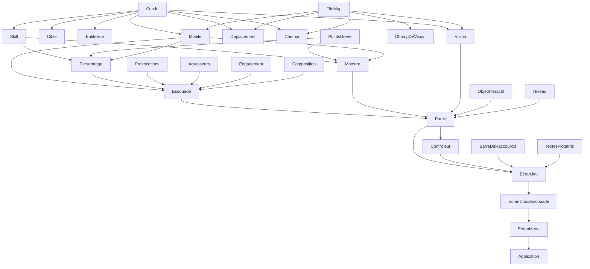

# Squad-ARPG — Audit du code avant l'étape 80

Audit en lecture seule, réalisé après l'étape 79 (commit `3a8e3e9`). Aucun fichier de `src/`,
`tests/` ni `CMakeLists.txt` n'a été modifié ni déplacé ; les builds d'essai et les micro-bancs ont
été faits dans un dossier temporaire hors du dépôt. Le constat décrit le code d'aujourd'hui ; une
proposition qui prépare une extension déjà connue (gambits, types de monstres, mana, nouveaux
types de skills, niveaux et arbres de skills, interface de placement des skills, touches
configurables, carte extérieure, peut-être un jour Unreal Engine) n'est faite que si elle sert dès
maintenant. L'audit précédent (avant l'étape 49) est entièrement traité ; son résumé est dans
`docs/historique.md`.

**Suivi.** L'étape 80 a traité B1, B2 (et le premier passage de `clang-tidy`, à la fin de ce
fichier), T1, T2, T3, C1, C4, D6, K2 a à f, V1 partie 1 et L1 (voir `ROADMAP.md`, `docs/build.md`,
`docs/tests.md`, `docs/combat.md`). C1 a montré que les sites d'`engagerSkill` pouvaient réellement
échouer (lanceur déjà occupé par un autre de ses skills) : nouvelle règle, le skill attend (voir
`docs/combat.md`, « Skill demandé pendant l'activation d'un autre »). Le plan des étapes suivantes
(81 : dossiers, P1, K1, K3 ; 82 : alléger `Escouade` ; les autres constats rattachés aux
fonctionnalités qui en ont besoin) et les décisions reportées sont dans `ROADMAP.md`. La partie
82.1 de l'étape 82 a traité D1 (`Vitalite`, `cercleDuRectangle` et `Mobile::getCercle`,
`s_eclaircissementExecution` dans `Eclaircir.hpp` ; le trio d'attaque, qui relève de R4, et
`s_pointsDeVieMax`, deux valeurs d'équilibrage indépendantes, n'ont pas été touchés). La partie
82.2 a fait le premier pas de R1 : le groupe (a), la formation (voir R1, « Suivi »).

Référentiels : C++ Core Guidelines, SOLID (surtout responsabilité unique et inversion des
dépendances), cohésion et couplage, DRY, règle du zéro, sémantique de valeur, *Game Programming
Patterns* (R. Nystrom) pour la boucle de jeu, `ARCHITECTURE.md` et `CLAUDE.md` pour les conventions
du projet.

---

## Synthèse

### Les cinq constats les plus importants

1. **`Escouade` est redevenue une classe-dieu** (R1) : 1 199 lignes (15 % de `src/`), 42 fonctions
   publiques, 31 privées, 18 membres. Formation, combat, skills, places d'attaque, règle de
   dégagement et ~25 accesseurs pour les autres couches y cohabitent. C'est là que les gambits et
   les nouveaux skills viendraient s'ajouter.
2. **Les skills se décident par `if` sur `TypeSkill`, à cinq endroits, avec trois canaux de sortie
   différents** (R4) : `Coup` pour les dégâts, `SoinApplique` pour les soins, un appel direct à
   `provoquer`. Buffs, affaiblissements, soins dans le temps et auras obligeraient à toucher cinq
   fonctions et à créer un quatrième canal.
3. **Le pistage des monstres coûte un temps quadratique** (V1) : `coutDesObstacles` représente
   74 % d'un `allerVers`, appelé à chaque image par chaque monstre en poursuite. Mesuré : 6 monstres en
   poursuite = 1,4 ms par image, 12 = 6,6 ms, 24 = 31 ms (budget à 60 images/s : 16,7 ms). Le
   build actuel n'a **aucun type de build** (`CMAKE_BUILD_TYPE` vide : pas d'optimisation, `assert`
   actifs), ce qui est le pire cas ; en `-O2` les mêmes 24 monstres coûtent 1,9 ms (B1).
4. **Les tests sont liés aux valeurs réelles du catalogue** (T1) : 283 usages de `uneEscouade`,
   `unePartie`, `compositionDeTest`. Mesuré sur une copie : passer les dégâts de l'attaque de base de 5
   à 6 fait échouer **30 tests** de logique (`Escouade` et `Partie`), la portée de mêlée de 20 à 25 px
   en fait échouer 10, les points de vie des monstres de 100 à 120 en font échouer 13. Chaque
   rééquilibrage (déjà annoncé : paladin et rôdeur « provisoires », arbres de skills) coûtera cher.
5. **Documentation lourde et en retard** (K1, K2, K3) : `CLAUDE.md` importe `ARCHITECTURE.md`
   (111 Ko) et `ROADMAP.md` (50 Ko) à chaque session, soit environ 40 000 jetons avant d'avoir
   écrit une ligne ; plusieurs phrases sont périmées (`main.cpp` cité comme faisant la boucle, « 4
   `Personnage` », « touches 1 à 4 ») et `docs/historique.md` s'arrête à l'étape 73.

En plus : le rendu est mélangé à la logique dans 6 classes du noyau (M1), `Partie` grossit (R3), le
pas de temps n'est pas borné (L1), et l'organisation en dossiers devient utile à 100 fichiers dans
`src/` (section « Organisation en dossiers »).

Bonne nouvelle : aucun cycle d'inclusion, tous les en-têtes se compilent seuls, aucun avertissement
avec les options du projet, les 887 tests passent aussi avec `_GLIBCXX_ASSERTIONS` et UBSan (mode
piège), les fonctions sont courtes (la plus longue : 76 lignes), et les règles d'architecture sont
respectées (une seule dépendance montante, voir « Organisation en dossiers »).

### Tableau récapitulatif

| ID | Titre | Gravité | Coût | Étape |
|---|---|---|---|---|
| R1 | `Escouade` porte au moins six responsabilités | haute | gros | 3 |
| R2 | Couplage temporel `attaquer` / `mettreAJour` et état partagé | moyenne | petit | 3 |
| R3 | `Partie` accumule objets interactifs, journal d'événements, groupes | moyenne | moyen | 5 |
| R4 | Skills : le type décide partout, trois canaux de sortie | haute | gros | 4 |
| R5 | Identifiants et places : `int`, `size_t`, 1 à N contre 0 à N−1 | moyenne | moyen | 3 |
| R6 | `EcranJeu` mélange décisions pures et appels SFML | basse | petit | 6 |
| M1 | `dessiner` dans six classes du noyau | moyenne | moyen | 6 |
| P1 | `Reglages` dépend de `BarreDeRaccourcis` ; `Controleur` mal placé | basse | petit | 2 |
| P2 | Écrans : en-tête parapluie SFML, appel au bureau dans une méthode testée | basse | petit | 6 |
| D1 | `Personnage` et `Monstre` : mêmes vitalité, cercle, constantes | moyenne | petit | 3 |
| D2 | Bornes de grille (5 fois) et indice `y * largeur + x` (7 fois) écrits à la main | basse | moyen | 5 |
| D3 | Huit fonctions publiques que seuls les tests appellent | basse | moyen | 3 |
| D4 | Les trois écrans de menu répètent le même patron | basse | petit | 6 |
| D5 | Petites duplications dans `Partie` et constantes jumelles | basse | petit | 5 |
| D6 | Restes : commentaires périmés, variables mortes dans les tests | basse | petit | 1 |
| C1 | Retours de `engager*` ignorés, déréférencements par invariant implicite | moyenne | petit | 1 |
| C2 | Constructeurs à longues listes de paramètres de même type | moyenne | petit | 4 |
| C3 | Conversions de signe (`-Wsign-conversion`) et 107 `static_cast` | basse | petit | 5 |
| C4 | `[[nodiscard]]`, `const`, `noexcept` appliqués de façon inégale | basse | petit | 1 |
| E1 | Valeurs d'équilibrage dispersées ; `Monstre` écrit ses valeurs en littéraux | moyenne | moyen | 4 |
| L1 | Pas de temps non borné | moyenne | petit | 1 |
| V1 | Chemins des monstres : coût quadratique | moyenne | petit | 1 |
| T1 | Les tests de logique dépendent des valeurs du catalogue | haute | moyen | 1 |
| T2 | Gros fichiers de tests, presque pas de `SECTION` | basse | petit | 1 |
| T3 | `aides.hpp` monolithique | basse | petit | 1 |
| T4 | Trous de couverture | basse | petit | 6 |
| B1 | Aucun type de build, pas de CTest, tests sans avertissements | moyenne | petit | 1 |
| B2 | Pas de `.clang-format` ni `.clang-tidy` ; outils d'analyse absents | basse | petit | 1 |
| K1 | Documentation chargée à chaque session : environ 40 000 jetons | moyenne | moyen | 2 |
| K2 | Écarts entre la documentation et le code | basse | petit | 1 |
| K3 | `docs/historique.md` s'arrête à l'étape 73 | basse | petit | 2 |

### Regroupement proposé en six étapes de refactorisation

Chaque étape se termine tests verts. Sauf mention, ce sont des refactorisations pures (aucune
règle de jeu ni valeur ne change). L'ordre commence par ce qui réduit le risque des suivantes :
d'abord le filet (tests indépendants du catalogue, build vérifiable), puis le rangement, puis les
gros découpages, puis le rendu.

**Étape 1 — Filet de sécurité et corrections locales** (petit à moyen, pas de dépendance).
T1 (tests indépendants du catalogue : l'étape la plus rentable avant tout rééquilibrage ou
découpage), T2, T3, B1, B2 (propositions), C1, C4, D6, K2, V1 (partie pure : `coutDesObstacles`
ne regarde que les cases voisines de chaque obstacle), L1 (**n'est pas une refactorisation pure** :
elle borne `dt` ; à décider). Le risque est faible : le filet de tests existe, aucune structure ne
change.

**Étape 2 — Dossiers et documentation** (moyen). Voir « Organisation en dossiers » : un commit
`git mv` sans changement de code, puis un commit de réécriture des `#include`. P1 (placer
`Controleur` dans `interface/`, déplacer `s_emplacementsPrincipaux`), K1 (alléger ce que
`CLAUDE.md` importe), K3. Dépend de l'étape 1 seulement pour le filet de tests ; à faire avant les
découpages, pour que les nouveaux fichiers naissent au bon endroit.

**Étape 3 — Alléger `Escouade`** (gros, en quatre sous-étapes). R1 (`Formation`, puis
`PlacesDAttaque`, puis le choix du point visé), R2 (couplage temporel), D1 (`Vitalite`,
`Mobile::getCercle`), D3 (retirer ou isoler l'API de test), R5 en dernier (types forts `Place` et
`IdMonstre`, optionnel). Dépend de l'étape 2. Les 221 tests d'`Escouade` servent de filet : on
garde l'interface publique tant que l'extraction n'est pas finie.

**Étape 4 — Skills en effets et données** (gros). R4 (`DefinitionDeSkill`, mode de cible séparé de
l'effet, une seule sortie d'effets), C2 (constructeurs à paramètres nommés), E1 (`ParametresMonstre`
sur le modèle de `ParametresDonjon`, qui prépare les types de monstres). Dépend de l'étape 3
(la partie « skills » d'`Escouade` y est isolée d'abord). À faire **avant** d'ajouter buffs, soins
dans le temps, auras ou mana.

**Étape 5 — `Partie`, grille** (moyen). R3 (`Interactions` pour les portes et les objets, journal
d'événements), D2 (une classe `Grille`), C3 (les conversions de signe disparaissent avec elle), D5. Indépendante de l'étape 4 : les deux peuvent être
permutées. Prépare les objets interactifs variés et la carte extérieure.

**Étape 6 — Séparer le rendu** (moyen à gros). M1 (fonctions de dessin dans `interface/rendu/`,
lisant le noyau par des accesseurs `const`), R6, D4, P2, T4 (tests de ce qui devient pur). À faire
en dernier : séparer le dessin de classes qui vont encore bouger (étapes 3 et 4) obligerait à le
refaire.

Décision à prendre avec Claude.ai, hors étapes : V1 (seconde partie) change le comportement des
monstres (recalcul du chemin moins fréquent), donc n'est pas une refactorisation pure.

---

## Mesures

### Taille

| Mesure | Valeur |
|---|---|
| `src/` | 7 795 lignes en 100 fichiers (56 `.hpp`, 44 `.cpp`, 57 modules) |
| `tests/` | 12 863 lignes en 45 fichiers (44 `test_*.cpp` + `aides.hpp`) ; ratio tests / src = 1,65 |
| Tests | 887 `TEST_CASE`, 36 011 assertions ; suite complète en 11,6 s (build `-O0`) |
| Documentation | `ARCHITECTURE.md` 1 059 lignes (111 Ko), `ROADMAP.md` 655 (50 Ko), `CLAUDE.md` 114 (6 Ko), `docs/` 13 fichiers (~500 Ko, dont `historique.md` 101 Ko, `tests.md` 81 Ko, `combat.md` 73 Ko) |
| Modules sans fichier de test dédié | `Application`, `main`, `EcranJeu`, `EcranDeFin`, `TraceDeChemin`, `Niveau` (boucle et dessin ; `creerNiveau` est utilisée par les tests) |

Plus gros fichiers de `src/` : `Escouade.cpp` 1 199 lignes, `Partie.cpp` 436, `Personnage.cpp` 299,
`Monstre.cpp` 264, `GenerateurDonjon.cpp` 264, `ChampDeVision.cpp` 257, `Chemin.cpp` 224,
`Escouade.hpp` 197, `EcranJeu.cpp` 185. Plus gros fichiers de tests : `test_Partie.cpp` 1 165,
`test_Escouade_skills.cpp` 1 044, `test_Monstre.cpp` 988, `test_GenerateurDonjon.cpp` 810,
`test_Personnage.cpp` 805, `test_Escouade_deplacement.cpp` 712.

### Les 15 fonctions les plus longues (de la signature à l'accolade fermante)

| Lignes | Fonction |
|---|---|
| 76 | `trouverChemin` (`Chemin.cpp`) : A*, un seul niveau de décision |
| 72 | `Monstre::mettreAJour` : états, soin du retour, ordres de déplacement |
| 63 | `Escouade::pointVersMonstre` : places d'attaque |
| 61 | `dessinerBarreDeSkills` |
| 60 | `Escouade::declencherSkill` |
| 57 | `creerNiveau` (données) |
| 53 | `TileMap::trajetLibre` ; `Escouade::choisirCible` |
| 51 | `Escouade::calculerPlaces` |
| 50 | `EcranJeu::traiterEvenement` |
| 48 | `Escouade::avancerSkillEnAttente` |
| 45 | `Escouade::pointVoulu` |
| 44 | `Escouade::separerPersonnages` |
| 42 | `Partie::resoudreLesCoups` ; `deplacerAvecGlissement` |

Huit des quinze sont dans `Escouade.cpp`. Aucune fonction ne dépasse 76 lignes (398 fonctions
mesurées dans `src/`).

### Classes : fonctions publiques, privées, membres (comptage approché)

| Classe | Publiques | Privées | Membres |
|---|---|---|---|
| `Escouade` | 42 | 31 | 18 |
| `Personnage` | ~35 | 2 | 10 |
| `Partie` | 16 | 18 | 11 |
| `Monstre` | ~22 | 2 | 13 |
| `Skill` | 14 | 1 | 11 |
| `TileMap` | 12 | 1 | 4 |
| `Mobile` | 12 | 0 | 7 |
| `Controleur` | 9 | 0 | 2 |
| `EcranJeu` | 4 | 2 | 8 |

### Tests par fichier (les plus gros)

`test_Monstre` 78, `test_Escouade_skills` 76, `test_Partie` 66, `test_Personnage` 64,
`test_GenerateurDonjon` 61, `test_Escouade_deplacement` 38, `test_TileMap` 36, `test_Escouade_combat`
36, `test_Escouade_agresseurs` 29, `test_Engagement` 27, `test_Chemin` 27. `SECTION` n'apparaît que
dans 2 fichiers (17 usages) ; le plus long `TEST_CASE` fait 44 lignes.

### Dépendances entre modules (graphe des `#include` de `src/`)

Aucun cycle, que l'on compte les `.hpp` seuls ou les `.hpp` et `.cpp`. Les 56 en-têtes compilent
chacun seul (`g++ -fsyntax-only`). Modules les plus inclus : `Cercle` (14 modules), `TileMap` (10),
`IdSkill` (8), `Aleatoire` (7), `EntiteVue` (6). Modules qui incluent le plus : `Escouade` (23),
`EcranJeu` (16), `Partie` (15), `Personnage` (14), `Monstre` (13).

Une flèche A → B signifie « B inclut A » (extrait, pas exhaustif).



Le noyau ne connaît pas l'interface : sauf `Controleur` (voir P1), aucun module ne dépend d'un
module « plus haut ». Il connaît en revanche **SFML Graphics** : 12 fichiers (6 classes, `.hpp` et `.cpp`)
incluent `RenderTarget` ou une forme (voir M1). Un seul fichier inclut l'en-tête parapluie `<SFML/Graphics.hpp>` :
`EcranJeu.cpp` (6,0 s de compilation, le plus lent de `squad_core`).

### Compilation et analyse

| Outil | Résultat |
|---|---|
| `g++` 16.2, options du projet (`-Wall -Wextra -Wpedantic -Wshadow -Wconversion`) | 0 avertissement dans `src/` |
| `g++` avec en plus `-Wsign-conversion -Wold-style-cast -Wuseless-cast -Wnon-virtual-dtor -Woverloaded-virtual -Wcast-align -Wduplicated-cond -Wlogical-op -Wnull-dereference -Wdouble-promotion -Wformat=2 -Wimplicit-fallthrough` (build séparé, tout le projet, tests compris) | 54 avertissements : 19 `-Wsign-conversion` dans `src/` (`Chemin.cpp` 10, `TileMap.cpp` 9), 4 dans les tests, 12 `-Wmissing-field-initializers` (tests : `Niveau` sans `armureMonstres`), 19 `-Wunused-but-set-variable` (variables `generateur` jamais lues dans 5 fichiers de tests). Rien pour les 11 autres options |
| Compilation de chaque `.hpp` seul | 56 sur 56 passent |
| Tests avec `-O1 -D_GLIBCXX_ASSERTIONS -fsanitize=undefined -fsanitize-undefined-trap-on-error` | 887 tests, 36 011 assertions : tout passe, aucun piège déclenché |
| clang-tidy, clang++, clang-format, cppcheck | **non disponibles** (non installés) |
| ASan, UBSan avec bibliothèque d'exécution | **non disponibles** : `libasan` et `libubsan` absentes du MinGW UCRT64 installé (d'où le mode « piège » d'UBSan, qui n'en a pas besoin) |

Temps de compilation : 88 objets, 280 s de CPU cumulés en `Debug` (quelques secondes chacun : 2,3 s
pour le plus petit test, 9,2 s pour `test_Escouade_skills.cpp`, 6,0 s `EcranJeu.cpp`, 5,8 s
`Application.cpp`, 5,3 s `Escouade.cpp`).

### Performance (micro-bancs hors dépôt, un cœur)

Image complète de `Partie::mettreAJour`, escouade de 3 :

| Scénario | `-O0` (build actuel) | `-O2` |
|---|---|---|
| Parties générées (graines 1 à 6, 11 à 16 monstres, 3 600 images), aucun monstre en poursuite | moyenne 0,11 à 0,15 ms, max 0,30 ms | moyenne 0,025 ms, max 0,25 ms |
| 6 monstres en poursuite | 1,4 ms (max 2,8) | 0,10 ms |
| 12 monstres en poursuite | 6,6 ms (max 9,9) | 0,40 ms |
| 24 monstres en poursuite | 30,6 ms (max 39,8) | 1,9 ms |

Coût d'un appel (`-O0`, 23 cercles à contourner, carte de 59 × 40) : `coutDesObstacles` 1,41 ms,
`trouverChemin` 0,41 ms, `Mobile::allerVers` complet 1,91 ms, `ligneDeVue` sur 600 px 0,004 ms. La
ligne de vue n'est donc pas un point chaud. Dessin (`Vision::dessiner` reconstruit jusqu'à ~14 000
sommets par image) : non mesuré, il demande une fenêtre. Les cinq tests de `test_Partie.cpp` qui
font poursuivre 30 monstres durent environ 1,2 s chacun en `-O0`.

---

## R — Responsabilités

### R1 — `Escouade` porte au moins six responsabilités
- **Constat** : `Escouade.cpp` fait 1 199 lignes pour 42 fonctions publiques, 31 privées et 18
  données membres, dont la plupart ne servent qu'à un seul groupe de fonctions. Les groupes, avec
  leur poids approximatif : (a) la formation : orientation, rotation, places théoriques et repliées,
  séparation douce (`tournerFormation`, `calculerPlaces`, `separerPersonnages`, ~150 lignes ;
  membres `m_decalages`, `m_orientation*`, `m_pointARegarder`, `m_vitesseRotation`, `m_places`) ;
  (b) le placement autour des monstres : `pointVersMonstre` (63), `pointVersAgresseur`,
  `monstresAContourner`, `porteeDe`, `m_placesDAttaque` (~110) ; (c) la décision « vers où marche
  chaque personnage » : `pointVoulu` (45), `degagementVoulu` (25), `mettreAJourDegagements`,
  `m_degagements` (~80) ; (d) les skills : `declencherSkill` (60), `choisirCible` (53),
  `avancerSkillEnAttente` (48), `effetDuSkill` (41), `declencherSkillDeZone`, `avancerSkillDe`,
  les trois `engager*`, `m_skillEnAttente`, `m_soinsAppliques` (~330) ; (e) le combat verrouillé :
  `attaquer`, `approcherVerrou`, `autodefense`, `verrouiller`, `m_cibleVerrouillee`,
  `m_cibleCombat` (~90) ; (f) ~25 accesseurs pour les autres couches (barre de raccourcis :
  `etatDuSkill`, `typeDuSkill`, `couleurDuPersonnage`, `adressesDesSkills`, `rayonZoneDuSkill` ;
  monstres : `proieDuMonstre`, `candidatsDeFrappe`, `recevoirCoup` ; vision :
  `cerclesDeVision` ; engagement : `entitesDeControle` ; débogage) ; (g) deux fonctions de dessin.
  Les groupes (a), (b) et (c) ne lisent presque aucun état commun avec (d) et (e). Le commentaire
  de `degagementVoulu` annonce lui-même qu'il est « le point de remplacement des futurs gambits ».
- **Où** : `Escouade.hpp`, `Escouade.cpp`.
- **Principe** : responsabilité unique ; cohésion ; Core Guidelines C.131 (éviter les
  accesseurs triviaux en série).
- **Gravité** : haute (chaque étape de combat y ajoute des membres ; les gambits y arriveront).
- **Proposition** : extraire dans l'ordre, chacun possédé **par valeur** par `Escouade`, jamais par
  héritage, et chacun testable seul parce qu'il ne reçoit que des positions, des rayons et des
  cercles (comme `Provocations` et `Agresseurs` à l'étape 51) :
  1. `Formation` (`escouade/Formation.hpp`) : décalages, orientation voulue et courante, point à
     regarder, vitesse de rotation, places. Fonctions : `pointARegarder(point)`, `orienter(...)`,
     `tourner(dt)`, `placeTheorique(indice, centreAncre)`, `calculerPlaces(centreAncre, rayons,
     carte, cerclesMonstres)`, `separer(...)`. Ne connaît pas `Personnage` (reçoit une liste de
     rayons et de positions). Les 4 tests de rotation, les 9 de `places` et une partie des 29
     d'`agresseurs` migrent.
  2. `PlacesDAttaque` (`escouade/PlacesDAttaque.hpp`) : `m_placesDAttaque` et le contenu de
     `pointVersMonstre` ; reçoit les occupants (`struct Occupant { sf::Vector2f centre; bool
     immobile; }`). C'est exactement la fonction dont les monstres qui encerclent auront besoin
     (`Encerclement.hpp` le prévoit déjà).
  3. `ChoixDuPointVise` (`escouade/ChoixDuPointVise.hpp`) : `pointVoulu` et `degagementVoulu`
     comme une suite ordonnée de petites règles (exécution, skill en attente, dégagement, verrou,
     agresseur, formation) qui prend une `struct SituationDuPersonnage` et renvoie le point et la
     règle appliquée. Aucun gambit n'est écrit : on isole l'endroit où ils iront (voir
     `docs/brainstorm.md`). F3 pourrait afficher la règle retenue.
  4. La partie skills : voir R4.
  `Escouade` garde l'ancre, les personnages, le verrou et l'orchestration (~400 lignes). Les
  accesseurs (f) se réduisent d'eux-mêmes quand R5 et D3 sont faits.
- **Coût** : gros (quatre sous-étapes indépendantes de ~1 jour chacune).
- **Risque et tests touchés** : moyen. Les 221 tests d'`Escouade` (7 fichiers) restent valides tant
  que l'interface publique ne change pas ; chaque type extrait reçoit ses propres tests (les cas
  de `test_Escouade_places.cpp` et `test_Escouade_degagement.cpp` s'y prêtent). L'ordre d'appel
  à l'intérieur de `mettreAJour` doit rester celui d'aujourd'hui (voir R2).
- **Dépend de** : étape 2 (dossiers) ; T1 (filet) ; R2 en même temps.
- **Suivi** :
  - **82.2, groupe (a) fait** : `Formation` (`escouade/Formation`) possède les décalages,
    l'orientation voulue et courante, le point à regarder, la vitesse de rotation et les places ;
    `tournerFormation`, `calculerPlaces`, `placePersonnage` et les six membres de formation ont
    quitté `Escouade`, remplacés par `m_formation`. Interface plus courte que la proposition :
    `regarderVers`, `oublierPointARegarder`, `choisirOrientation` (avant le déplacement de
    l'ancre), `mettreAJour` (rotation puis places, après) et `getPlaces` ; `placeTheorique` et
    `tourner` sont privées. La séparation n'est pas dans `Formation` mais dans une fonction pure à
    part (`escouade/Separation`, `pousseesDeSeparation`), qui reçoit un centre et un état
    `Absent`/`Fixe`/`Libre` par personnage ; `separerPersonnages` ne fait plus que traduire et
    appliquer. `s_ecartEntrePersonnages` est dans l'en-tête neutre `escouade/EcartEntrePersonnages.hpp`.
    Aucun comportement changé : calcul de la séparation déjà simultané, aucun test existant modifié
    (904 → 927 avec les 23 tests de `Formation` et `Separation`). `Escouade.cpp` : 1 223 → 1 112
    lignes. Les tests de rotation et de places d'`Escouade` restent le filet ; les doublons seront
    triés en 82.5.

### R2 — Couplage temporel entre `attaquer` et `mettreAJour`
- **Constat** : `Escouade.hpp` l. 30–33 impose « `attaquer()` AVANT `mettreAJour()` » parce que
  `attaquer()` calcule `m_monstreAPortee` (dans `autodefense`) et `m_cibleCombat` (dans
  `approcherVerrou`), que `mettreAJour()` lit ensuite (`pointVersAgresseur`, `pointVoulu`,
  `avancerSkillEnAttente`). Dans l'ordre inverse, les personnages réagissent avec une image de
  retard, sans aucune erreur. Les helpers de test (`simulerAvecAttaque`) et `Partie` doivent
  respecter cet ordre. `m_monstreAPortee` est de nouveau un `std::vector<bool>` (l'étape 49 l'avait
  mis en `std::array` quand il y avait toujours 4 personnages). De plus
  `pointVoulu` déréférence `m_skillEnAttente->adresse` parce que `pointSkill.has_value()` : un
  invariant implicite entre deux fonctions.
- **Où** : `Escouade.hpp`, `autodefense`, `approcherVerrou`, `pointVoulu`.
- **Principe** : éviter l'état partagé entre deux appels ordonnés ; fonctions qui ne dépendent que
  de leurs arguments.
- **Gravité** : moyenne.
- **Proposition** : calculer ces deux valeurs là où elles sont lues. `mettreAJour` reçoit déjà
  `monstres` et `carte` : `monstresAPortee` devient une variable locale de `mettreAJour` (calculée
  par la même règle `choisirCibleAFrapper` + `peutAtteindre`) et `m_cibleCombat` se retrouve par
  `trouverEntite(monstres, *m_cibleVerrouillee)`. Attention : `attaquer` reçoit les monstres
  ciblables et `mettreAJour` tous les monstres ; la différence est un monstre en retour, que
  `Partie` a déjà dé-verrouillé, donc le résultat est identique, sauf cas limites (verrou posé sur
  un monstre absent de la liste) que les tests existants doivent confirmer. L'ordre d'appel cesse d'être une
  règle. `pointVoulu` reçoit le point du skill en attente avec l'adresse (une petite structure) plutôt
  que de relire `m_skillEnAttente`.
- **Coût** : petit à moyen.
- **Risque et tests touchés** : moyen (c'est du comportement de timing) ; les tests d'`Escouade`
  qui appellent `attaquer` sans `mettreAJour` (`attaquerJusquAuDepart`) ne changent pas.
- **Dépend de** : R1 (plus simple une fois `ChoixDuPointVise` isolé).

### R3 — `Partie` accumule plusieurs rôles
- **Constat** : `Partie` (436 lignes, 16 fonctions publiques, 18 privées, 11 membres) est à la fois
  l'orchestrateur d'une image (`mettreAJour`), le gestionnaire des objets interactifs (portes :
  `m_objets`, `m_interactionEnCours`, `trouverObjetActif`, `ouvrir`, `interagirSiAPortee`, la
  branche `Objet` de `cliquer`, ~90 lignes), le producteur de la file d'événements (`m_evenements`,
  `signaler`, `signalerLesSoins`, `prendreEvenements`), le coordinateur des groupes
  (`alerterLesGroupes`), le propriétaire de la règle d'engagement (photographies des camps), et
  porte trois fonctions de dessin de débogage. `cliquer` (38 lignes) mêle quatre cas. Chaque
  étape y a ajouté un bloc (portes à l'étape 70, vision à la 72, engagement à la 77, événements à
  la 79) ; les objets interactifs variés (coffres, leviers, escaliers) et la carte extérieure sont
  annoncés.
- **Où** : `Partie.hpp`, `Partie.cpp`.
- **Principe** : responsabilité unique ; ouvert à l'extension pour les types d'objets.
- **Gravité** : moyenne.
- **Proposition** : (a) `Interactions` (`jeu/Interactions.hpp`) : possède `m_objets` et
  `m_interactionEnCours` ; `std::optional<Interaction> objetCliquable(point, carte, vision)`,
  `void ouvrirSiAPortee(const Escouade&, TileMap&)`. `Partie::cliquer` garde l'ordre de priorité (monstre,
  objet, sol). (b) `JournalDeCombat` (`jeu/JournalDeCombat.hpp`) : `m_evenements`, `signaler`,
  `prendreEvenements` ; `Partie` lui passe les montants appliqués. (c) Dans `cliquer`, une fonction
  `leverLeVerrou()` pour la séquence `deverrouiller` + `annulerAttaquesEngagees` écrite trois fois
  (voir D5). Rien d'autre ne bouge : `Partie` garde l'ordre d'une image.
- **Coût** : moyen.
- **Risque et tests touchés** : faible à moyen ; les 66 tests de `Partie` servent de filet ;
  `test_ObjetInteractif.cpp` s'étend naturellement.
- **Dépend de** : étape 2 (dossiers) ; indépendante de R1 et R4.

### R4 — Skills : le type décide partout, trois canaux de sortie
- **Constat** : le type du skill décide en cinq endroits, dont quatre testent `TypeSkill` (4
  valeurs) : `Escouade::declencherSkill` (provocation, puis zone, puis visite de la cible),
  `Escouade::choisirCible` (zone ou provocation → rien, dégâts, sinon soin),
  `Escouade::declencherSkillDeZone` (`!= Zone`) et `Controleur::activerEmplacement` (`== Zone`
  décide de la visée) ; le cinquième, `Escouade::effetDuSkill`, déduit la provocation de l'absence
  de cible. `Skill::m_puissance` veut
  dire dégâts, points de vie rendus, secondes (convertie en `float` à l'usage) ou dégâts de zone
  selon le type, et `m_rayonZone` n'est lu que pour deux types sur quatre. Les effets sortent par
  trois voies : `Coup` (dégâts, renvoyé par `attaquer` et `declencher*`), `SoinApplique` (soins,
  accumulés puis repris par `prendreSoins`) et un appel direct à `provoquer` dans `effetDuSkill`.
  `EvenementDeCombat` est une quatrième forme, produite par `Partie`. Les extensions connues
  (buffs, affaiblissements, soins dans le temps, auras à bascule, mana, arbres de skills) doivent
  chacune modifier les cinq endroits et ajouter un canal.
- **Où** : `Skill.hpp`, `TypeSkill.hpp`, `Escouade.cpp` (l. 260–300, 331–390, 459–485, 1127–1179),
  `Controleur.cpp` l. 54, `Coup.hpp`, `Escouade::prendreSoins`.
- **Principe** : ouvert/fermé ; une décision par type écrite une seule fois ; données plutôt que
  `switch` répétés.
- **Gravité** : haute pour la suite (moyenne aujourd'hui : cinq `if` lisibles).
- **Proposition** (refactorisation pure possible, en quatre pas qui compilent chacun) :
  1. `struct DefinitionDeSkill` (voir C2) pour construire un `Skill`.
  2. Séparer **comment on vise** de **ce que ça fait** : `enum class ModeDeCible { Soi, Monstre,
     Allie, Point }` (porté par la définition) remplace les tests `Zone`/`Provocation` pour viser
     (`choisirCible`, `declencherSkill`, `activerEmplacement` demandent « le mode »), et
     `std::variant<EffetDegats, EffetSoin, EffetProvocation, EffetDegatsDeZone>` décrit l'effet,
     chacun avec ses propres champs (`EffetProvocation { float duree; float rayon; }`,
     `EffetDegatsDeZone { int degats; float rayon; }`). `puissance` et `rayonZone` cessent d'être
     surchargés.
  3. `effetDuSkill` devient un `std::visit` sur l'effet et renvoie **une seule** liste de
     résultats (`ResultatDEffet = std::variant<DegatsSurMonstre, SoinSurAllie, ProvocationPosee>`),
     que `Partie` traduit en `EvenementDeCombat` : `SoinApplique`, `prendreSoins` et l'appel direct
     à `provoquer` disparaissent.
  4. `TypeSkill` reste seulement comme étiquette si l'affichage en a besoin ; sinon on le retire.
  Les huit skills actuels deviennent des valeurs de
  données, comme le sont déjà les classes (`Specialite`). Un nouveau type d'effet = une
  alternative de `std::variant` : le compilateur signale chaque `visit` à compléter (c'est déjà la
  technique de `Cible`).
- **Coût** : gros.
- **Risque et tests touchés** : moyen. `test_Skill.cpp` (24), `test_Escouade_skills.cpp` (76),
  `test_Personnage.cpp` (64), `test_Partie.cpp`, `test_Controleur.cpp` ; les assertions sur `Coup`
  deviennent des assertions sur `DegatsSurMonstre` (changement mécanique). Écrire ces tests sans
  dépendre du catalogue (T1) d'abord.
- **Dépend de** : R1 (la partie skills est isolée d'abord), C2, T1.

### R5 — Identifiants et places : `int`, `size_t`, 1 à N contre 0 à N−1
- **Constat** : un `int id` désigne tantôt un monstre (`Coup.idMonstre`, `EntiteVue.id`), tantôt
  une place de personnage (`EntiteVue.id` côté personnages, `CoupDOpportunite.idAttaquant` et
  `idCible`, `EvenementDeCombat.idCible` dont le sens dépend de `campCible`). La place est un
  `std::size_t` de 1 à N dans `AdresseSkill`, `CibleAllie`, `Provocation`, mais un `indice` de 0 à
  N−1 dans les boucles : `indice + 1` ou `place - 1` apparaît 7 fois dans `Escouade.cpp`,
  `static_cast<std::size_t>(...id)` 4 fois dans `Partie.cpp` et `Escouade.cpp`,
  `static_cast<int>(place)` ou équivalent 4 fois. La seule conversion « officielle » est `indiceDeLaPlace`.
  Aucun cas de confusion n'a été trouvé aujourd'hui : c'est une règle tenue à la main.
- **Où** : `EntiteVue.hpp`, `Engagement.hpp`, `EvenementDeCombat.hpp`, `Cible.hpp`,
  `AdresseSkill.hpp`, `Escouade.cpp`, `Partie.cpp`.
- **Principe** : types forts ; rendre les états illégaux non représentables.
- **Gravité** : moyenne (grandit avec le nombre de places et d'identifiants).
- **Proposition** : deux petits types valeur, `struct Place { std::size_t numero; ... std::size_t
  indice() const; }` (la seule conversion, avec `assert(numero >= 1)`) et `struct IdMonstre { int
  valeur; }` ; `EntiteVue` devient générique ou en deux types (`EntiteVueMonstre`,
  `EntiteVuePersonnage`). À faire à la fin de l'étape 3, quand `Escouade` est plus petite, ou pas du
  tout si l'on juge que `assert` + tests suffisent.
- **Coût** : moyen (beaucoup de signatures, guidé par le compilateur).
- **Risque et tests touchés** : faible mais large : presque tous les tests d'`Escouade` et de
  `Partie` changent d'écriture.
- **Dépend de** : R1.

### R6 — `EcranJeu` mélange décisions pures et appels SFML
- **Constat** : `EcranJeu::traiterEvenement` (50 lignes) décide en un seul `if` en cascade quelle
  touche fait quoi (R seulement en fin de partie, F5, F3, F4, F6, sinon raccourci) et appelle
  SFML ; `dessiner` construit les 12 `IconeDeRaccourci` (fusion de la barre, de l'escouade, des
  réglages et de la visée). Ni l'une ni l'autre n'est testée (`EcranJeu` n'a pas de test).
- **Où** : `EcranJeu.cpp` l. 101–125 et 166–177.
- **Principe** : séparer la décision de son exécution ; tester ce qui est pur.
- **Gravité** : basse.
- **Proposition** : (a) `CommandeDeClavier commandePourTouche(Scancode, bool finDePartie, const
  TouchesDesRaccourcis&)` (un `std::variant` : `Quitter`, `NouvelleCarte`, `Basculer(Debogage)`,
  `ActiverEmplacement(i)`, `Rien`), testable ; (b) `std::array<IconeDeRaccourci,
  s_emplacementsPrincipaux> iconesDeLaBarre(...)` à côté de `BarreDeSkills`. `EcranJeu` redevient
  un traducteur.
- **Coût** : petit.
- **Risque et tests touchés** : faible ; deux nouveaux fichiers de tests.
- **Dépend de** : aucun (à faire avec M1).

---

## M — Séparation logique / rendu

### M1 — `dessiner` dans six classes du noyau
- **Constat** : `TileMap::dessiner`, `Vision::dessiner`, `Personnage::dessiner`,
  `Monstre::dessiner` / `dessinerChemin`, `Escouade::dessiner` / `dessinerPointsVises`,
  `Partie::dessiner` / `dessinerCheminsDesMonstres` / `dessinerZonesDeControle` créent des formes
  SFML (`RectangleShape`, `CircleShape`, `VertexArray`) dans les classes de règles : environ 150
  lignes sur 7 800, et 12 fichiers du noyau qui incluent `RenderTarget` ou une forme. Le projet
  l'assume (`ARCHITECTURE.md`), mais les évolutions visuelles annoncées (types de monstres,
  effets d'impact, indicateur de provocation, auras, nom du skill au-dessus du lanceur,
  semi-transparence) s'ajouteraient dans les classes de règles. Un éventuel portage de la logique
  vers Unreal obligerait à faire ce tri de toute façon.
- **Où** : fichiers cités ; `Controleur::dessinerApercu` (déjà dans la couche interface).
- **Principe** : séparation modèle / vue ; inversion des dépendances (le noyau ne dépend pas de la
  fenêtre).
- **Gravité** : moyenne (aucune gêne aujourd'hui ; coût qui croît avec chaque ajout visuel).
- **Évaluation de trois options** :
  - *Statu quo* : coût nul, gêne croissante.
  - *Fonctions de dessin libres dans `interface/rendu/`* qui lisent le noyau par des accesseurs
    `const` (`dessinerPersonnage(rendu, const Personnage&)`, `dessinerMonstre(rendu, const Monstre&,
    bool estCible, bool marquerLeRetour)`, `dessinerCarte(rendu, const TileMap&)`,
    `dessinerBrouillard(rendu, const Vision&)`, `dessinerPartie(rendu, const Partie&, const
    OptionsDeDebogage&)`). Les accesseurs existent déjà presque tous (`getCentre`, `getCercle`,
    `getCouleur`, `estVivant`, `estEnExecution`, `estCiblable`, `cibleEngagee`, `getPointsDeVie`,
    `cheminRestant`, `getTile`, `etat`, `pointVise`) ; il manque une taille (`Personnage::getTaille`,
    ou le rayon) et `Monstre::getPointsDeVieMax`. C'est la voie recommandée.
  - *Interface `Dessinable`* ou séparation en classes `PersonnageVue` : plus de code, un
    polymorphisme dont on n'a pas besoin.
- **Proposition** : l'option 2, **en dernier** (étape 6) : les classes à découper (R1, R4)
  bougent encore. Ordre intérieur : `TileMap` et `Vision` (données pures déjà), puis `Personnage`
  et `Monstre`, puis `Escouade` (ancre, points visés) et `Partie` (les trois fonctions de débogage).
  `BarreDeVie` et `TraceDeChemin` deviennent des primitives de `interface/rendu/`. `Controleur::
  dessinerApercu` les rejoint. Les couleurs de `DefinitionPersonnage` restent dans le noyau : c'est
  de la donnée d'apparence, pas du rendu.
- **Coût** : moyen (deux jours) à gros.
- **Risque et tests touchés** : faible (le dessin n'est pas testé ; vérification visuelle d'Olivier à
  chaque sous-étape). Aucun test de logique ne change ; quelques tests construisent
  `Personnage` ou `Monstre` sans fenêtre, ce qui continue de marcher.
- **Dépend de** : R1, R4 (ne pas découper ce qui va bouger) ; étape 2 (dossier `interface/rendu/`).

---

## P — Dépendances et couches

### P1 — `Reglages` dépend du modèle de la barre ; `Controleur` est dans la mauvaise couche
- **Constat** : `Reglages.hpp` inclut `BarreDeRaccourcis.hpp` seulement pour la constante
  `s_emplacementsPrincipaux` (la configuration dépend du HUD, et `Transition` dépend de
  `Reglages`). `Controleur` est « l'état d'interface » d'`EcranJeu` (`ARCHITECTURE.md`) mais il est
  rangé avec les règles de jeu : c'est le **seul** module qui inclut « vers le haut »
  (`Controleur.hpp` → `ClicInterface.hpp`, `Controleur.cpp` → `BarreDeRaccourcis.hpp`), selon les
  couches proposées plus bas.
- **Où** : `Reglages.hpp`, `Controleur.hpp/.cpp`.
- **Principe** : dépendances dirigées vers le bas ; inversion des dépendances.
- **Gravité** : basse.
- **Proposition** : ranger `Controleur` dans `interface/` (c'est un déplacement, voir
  « Organisation en dossiers ») ; mettre `s_emplacementsPrincipaux` dans un en-tête neutre
  (`interface/Raccourcis.hpp`, ou dans `Reglages.hpp` lui-même, la barre l'important) pour que
  `Reglages` n'inclue plus la barre.
- **Coût** : petit.
- **Risque et tests touchés** : aucun test.
- **Dépend de** : aucun (avec l'étape 2).

### P2 — Écrans : en-tête parapluie et appel au bureau dans une méthode testée
- **Constat** : (a) `EcranJeu.cpp` inclut `<SFML/Graphics.hpp>` (toute la bibliothèque) ; c'est
  le fichier le plus lent de `squad_core` (6,0 s) et il contredit la règle de `CLAUDE.md`.
  (b) `EcranMenu::cliquer` appelle `sf::VideoMode::getDesktopMode()` : la méthode, testée
  (4 tests), dépend du système d'affichage pour la branche « Options ». (c) `EcranChoixEscouade.cpp`
  inclut `EcranJeu.hpp` (donc `Partie`, `Escouade`…) seulement pour construire l'écran de jeu.
- **Où** : fichiers cités.
- **Principe** : en-têtes précis ; dépendances injectées plutôt que cherchées dans le système.
- **Gravité** : basse.
- **Proposition** : (a) remplacer par les 6 ou 7 en-têtes précis ; (b) passer les résolutions du
  bureau au constructeur d'`EcranMenu` (l'`Application` les connaît) ; (c) laisser tel quel (le
  patron *State* demande que le menu connaisse l'écran suivant).
- **Coût** : petit.
- **Risque et tests touchés** : `test_EcranMenu.cpp` s'enrichit d'un cas « Options ».
- **Dépend de** : aucun.

---

## D — Duplication et code mort

### D1 — `Personnage` et `Monstre` répètent la même vitalité
- **Constat** : les deux classes ont chacune `Mobile m_mobile`, `PointsDeVie m_pointsDeVie`, `int
  m_armure`, un `recevoirDegats` presque identique (`appliquerArmure` puis `subirDegats`), des
  façades `estVivant`, `getPointsDeVie`, `getCentre`, un `getCercle` identique
  (`{centre, taille.x / 2}` ; une troisième copie est `cercleDe` dans `Deplacement.cpp`), le même
  trio `engagerAttaque` / `avancerAttaque` / `annulerAttaque` sur un `Skill`, et deux constantes
  jumelles (`s_pointsDeVieMax = 100`, `s_eclaircissementExecution = 0.5f`). L'héritage `Entite` a
  été écarté à raison (audit précédent) ; la duplication qui reste est de la vitalité et de la
  géométrie.
- **Où** : `Personnage.cpp` l. 260–299, `Monstre.cpp` l. 66–128, `Deplacement.cpp`
  l. 22–24.
- **Principe** : DRY ; composition de petits types valeur.
- **Gravité** : moyenne (grossit avec chaque nouveau type d'entité).
- **Proposition** : (a) `Vitalite { PointsDeVie pv; int armure; }` avec `int subir(int montant)`
  (applique l'armure et renvoie ce qui a été retiré), `soigner`, `estVivant`, `ratio` : possédée par
  valeur par `Personnage` et `Monstre`, qui perdent chacune ~6 fonctions de façade ; elle absorbe
  `Defense` quand les armures varieront. (b) `Mobile::getCercle()`, utilisée par `Personnage`,
  `Monstre` et `Deplacement`. (c) Un seul endroit pour les deux constantes partagées (`Eclaircir.hpp`
  pour l'éclaircissement ; la vitalité par défaut dans `ParametresMonstre`, voir E1).
- **Coût** : petit.
- **Risque et tests touchés** : faible ; `test_PointsDeVie.cpp` et `test_Defense.cpp` couvrent déjà
  les deux briques, `test_Personnage.cpp` et `test_Monstre.cpp` ne changent pas.
- **Dépend de** : aucun (mieux avec R1).

### D2 — Les bornes de grille et l'indice `y * largeur + x` sont écrits à la main
- **Constat** : « la case (x, y) est-elle dans la carte » s'écrit à la main dans
  `TileMap::getTile`, `ChampDeVision.cpp` (`dansLaCarte`), `Vision::etat`, le lambda de
  `coutDesObstacles` et `GenerateurDonjon.cpp` (`estSol`) ; la formule d'indice est dans
  `TileMap::indice` (privée) et recopiée dans `Chemin.cpp` (3 fois), `Vision.cpp` (3 fois),
  soit 7 fois, plus 5 calculs de `largeur * hauteur`. C'est aussi la source des 19 `-Wsign-conversion` de `src/` (voir C3) : un
  `int` de grille indexe un `std::vector`.
- **Où** : fichiers cités.
- **Principe** : DRY ; un seul endroit pour une conversion délicate.
- **Gravité** : basse.
- **Proposition** : `template <class T> class Grille` (`monde/Grille.hpp`) : `largeur()`,
  `hauteur()`, `contient(sf::Vector2i)`, `at(sf::Vector2i)`, constructeur `(largeur, hauteur,
  valeur)` ; `TileMap` (`Grille<Tile>`), `Vision` (`Grille<EtatCase>`) et le masque d'obstacles de
  `coutDesObstacles` (`Grille<char>`, en évitant `vector<bool>`) l'utilisent. La conversion
  `int` → `size_t` vit à un seul endroit. Prépare la carte extérieure (plus grande).
- **Coût** : moyen.
- **Risque et tests touchés** : faible ; `test_TileMap.cpp` (36), `test_Vision.cpp`,
  `test_Chemin.cpp` servent de filet.
- **Dépend de** : étape 2.

### D3 — Huit fonctions publiques que seuls les tests appellent
- **Constat** : aucun appel dans `src/` pour `Escouade::recevoirDegats` (74 appels dans les
  tests), `getPlacesDeFormation`, `getAgresseurs`, `getProvocations`, `pointVise`,
  `degagementDuPersonnage`, `pointsDeVieDuPersonnage`, ni pour `Partie::getMonstres`. Elles
  gonflent l'interface d'`Escouade` (sept fonctions sur 42) et fixent des détails internes (les
  places, les mémoires) que les tests lisent. S'y ajoute le paramètre par défaut
  `monstresDeControle = {}` de `Escouade::mettreAJour`, que la production ne laisse jamais vide
  (`Partie` le passe toujours) : il n'existe que pour ~50 appels de tests.
- **Où** : `Escouade.hpp`, `Partie.hpp`.
- **Principe** : interface minimale ; pas de paramètre ou de fonction « pour plus tard » (règle 5 de
  `CLAUDE.md`, par symétrie).
- **Gravité** : basse.
- **Proposition** : (a) retirer `Escouade::recevoirDegats` en ajoutant dans `aides.hpp` un
  `inline int infliger(Escouade&, int idMonstre, sf::Vector2f origine, int quantite)` qui appelle
  `proieDuMonstre` puis `recevoirCoup` (remplacement mécanique de 74 appels) ; (b) `pointVise`
  devient utile à `dessinerPointsVises` quand le rendu sort d'`Escouade` (M1) ; les autres
  accesseurs migrent avec les types extraits de R1 et y restent publics ; (c) retirer la valeur par
  défaut et passer `{}` dans les tests, ou un helper `mettreAJourSansEngagement`.
- **Coût** : moyen (principalement mécanique).
- **Risque et tests touchés** : touche ~100 appels de tests, sans changer leur logique.
- **Dépend de** : R1.

### D4 — Les trois écrans de menu répètent le même patron
- **Constat** : `EcranMenu`, `EcranOptions` et `EcranChoixEscouade` ont chacun le même
  `traiterEvenement` (clic gauche → vue d'interface → conversion → `cliquer`), le même début de
  `dessiner` (`setView`, `clear`, curseur converti) et un `mettreAJour(float, const Contexte&) {}`
  vide. L'écran « Configurer les touches » annoncé en ferait un quatrième.
- **Où** : trois `.cpp` d'écrans.
- **Principe** : DRY.
- **Gravité** : basse.
- **Proposition** : une fonction libre `std::optional<sf::Vector2f> clicGaucheDInterface(const
  sf::Event&, const Contexte&)` dans `TailleDeVue.hpp`, et `preparerLInterface(const Contexte&)`
  (vue + `clear`, renvoie le curseur). Pas de classe de base `EcranDeMenu`.
- **Coût** : petit.
- **Risque et tests touchés** : aucun test ; vérification visuelle des trois menus.
- **Dépend de** : aucun.

### D5 — Petites duplications dans `Partie` et constantes jumelles
- **Constat** : dans `Partie.cpp`, la séquence `deverrouiller()` + `annulerAttaquesEngagees()` est
  écrite trois fois dans `cliquer` ; « lever le verrou si le monstre est mort ou en retour » trois
  fois (`appliquerLesCoupsDOpportunite`, deux fois dans `resoudreLesCoups`) ; `std::erase_if(m_monstres, ...
  !estVivant())` deux fois ; l'`std::find_if` « par identifiant » trois fois dans `Agresseurs` et
  `Provocations` (alors que `trouverEntite` existe). Constantes jumelles recopiées « comme celle
  de » : `s_toleranceArrivee` d'`Escouade.cpp` et `s_seuilMouvement` de `Mobile.cpp` (0,01 px, le
  premier commentaire dit « comme le seuil de Mobile ») ; `s_cote` 20 dans `Personnage.cpp` et
  `s_coteAncre` 20 dans `Escouade.cpp`.
- **Où** : fichiers cités.
- **Principe** : DRY ; une valeur qui sert deux fois a un nom (`CLAUDE.md`).
- **Gravité** : basse.
- **Proposition** : `Partie::leverLeVerrou()` et `Partie::retirerLesMorts()` ; `Mobile::s_seuilMouvement`
  publique, utilisée par `Escouade` ; `Agresseurs` et `Provocations` utilisent `std::ranges::find`
  avec projection (`&Provocation::id`).
- **Coût** : petit.
- **Risque et tests touchés** : faible.
- **Dépend de** : aucun (avec R3).

### D6 — Restes : commentaires périmés, variables mortes dans les tests
- **Constat** : `EcranJeu.cpp` l. 108 : `// retour au menu` alors que `Depiler` ramène au choix de
  l'escouade ; 19 variables `Generateur generateur = generateurDeTest();` jamais lues dans 5 fichiers
  de tests (`-Wunused-but-set-variable`), dont `simulerAttaque` (`test_Escouade_combat.cpp` l. 23) ;
  le test « estPerdue est faux tant qu'un personnage survit et vrai quand les 4 sont morts » parle
  de 4 personnages 
  
- **Où** : fichiers cités.
- **Principe** : les commentaires disent la vérité.
- **Gravité** : basse.
- **Proposition** : une passe de nettoyage ; ajouter `-Wunused` aux tests (voir B1) pour ne plus en
  laisser.
- **Coût** : petit.
- **Risque et tests touchés** : aucun.
- **Dépend de** : aucun.

---

## C — Idiomes C++

### C1 — Retours de `engager*` ignorés, déréférencements par invariant implicite
- **Constat** : `Personnage::engagerSkill` renvoie un `bool` qui est ignoré par
  `static_cast<void>(...)` six fois dans `Escouade.cpp` (l. 170, 213, 371, 381, 480, 525) : soit
  l'échec est impossible (alors un `assert` le dirait), soit il est possible et la demande est
  perdue en silence (le skill en attente est effacé juste après). `engagerAttaque` (`Personnage`,
  `Monstre`) est ignoré sans cast à `Escouade.cpp` l. 325 et `Partie.cpp` l. 343, sans
  `[[nodiscard]]`. Cinq déréférencements reposent sur un invariant que rien ne vérifie :
  `m_skillEnAttente->adresse` quand `pointSkill.has_value()` (`Escouade.cpp` l. 660),
  `proie->cercle.centre` en poursuite (`Monstre.cpp` l. 223), `*trouverEntite(candidats, *id)`
  (`Monstre.cpp` l. 154), `*trouverSkill(*m_actionEngagee->skill)` (`Personnage.cpp` l. 243, 255),
  `std::get<CibleMonstre>(*m_actionEngagee->cible)` (`Personnage.cpp` l. 142). `src/` contient 32
  `assert`, dont 1 dans `Escouade.cpp` (1 199 lignes), 0 dans `Partie.cpp`, `Monstre.cpp` et
  `Mobile.cpp`. Les 887 tests passent avec `_GLIBCXX_ASSERTIONS` : rien n'est cassé aujourd'hui, mais
  « skill en attente par personnage » (annoncé) rendra l'échec silencieux possible.
- **Où** : lignes citées.
- **Principe** : Core Guidelines I.6 / I.8 (préconditions exprimées) ; ne pas ignorer un échec.
- **Gravité** : moyenne.
- **Proposition** : `[[nodiscard]]` sur `engagerSkill` et `engagerAttaque` ; aux six sites,
  `const bool engage = ...; assert(engage);` (l'échec est exclu par le test qui précède : décision
  à confirmer site par site) ; un `assert` devant chacun des cinq déréférencements ; si l'un d'eux
  peut réellement échouer, le traiter.
- **Coût** : petit.
- **Risque et tests touchés** : faible ; si un `assert` échoue en test, c'est un bogue trouvé.
- **Dépend de** : aucun.

### C2 — Constructeurs à longues listes de paramètres de même type
- **Constat** : `Skill(TypeSkill, float portee, int puissance, float rechargeMin, float rechargeMax,
  float rayonZone, float tempsExecution)` : cinq `float` de suite, permutables sans erreur de
  compilation ; 9 constructions dans `Specialite.cpp` (de ~150 caractères chacune) et plus de 60 dans les tests
  (56 dans `test_Personnage.cpp`).
  `Personnage(centre, couleur, attaque, skills, armure, rayonVision, zoneDeControle = 0)` : 7
  paramètres. `Niveau` s'initialise en liste positionnelle dans les tests ; comme `armureMonstres`
  n'a pas de valeur par défaut alors que `portes` en a une, 12 avertissements
  `-Wmissing-field-initializers` apparaissent.
- **Où** : `Skill.hpp`, `Personnage.hpp`, `Specialite.cpp`, `Niveau.hpp`, tests.
- **Principe** : paramètres nommés par structure (C++20 : initialisation désignée) ; interfaces
  difficiles à mal utiliser.
- **Gravité** : moyenne (le risque d'une inversion portée / recharge augmente avec chaque skill).
- **Proposition** : `struct DefinitionDeSkill { TypeSkill type; float portee; int puissance; float
  rechargeMin; float rechargeMax; float rayonZone = 0; float tempsExecution = 0; }` et
  `explicit Skill(const DefinitionDeSkill&)` ; les appels s'écrivent
  `Skill({.type = TypeSkill::Degats, .portee = s_porteeMelee, ...})`. Même idée pour `Personnage`
  (il reçoit déjà presque une `DefinitionPersonnage` : lui passer la définition). `Niveau::
  armureMonstres = s_armureMonstresParDefaut`.
- **Coût** : petit (mécanique ; commencer par `Specialite.cpp`).
- **Risque et tests touchés** : faible ; compile-guidé ; les tests qui construisent des `Skill` à la
  main (`test_Skill.cpp`, `aides.hpp`) changent d'écriture.
- **Dépend de** : aucun (R4 l'utilise).

### C3 — Conversions de signe et `static_cast`
- **Constat** : avec `-Wsign-conversion`, 19 avertissements dans `src/` : `Chemin.cpp` (10, `int` de
  grille indexant des `std::vector`) et `TileMap.cpp` (9, idem), 4 dans les tests. `src/` contient
  107 `static_cast` (dont 4 pour convertir une place ou un identifiant : R5). `-Wold-style-cast` et
  `-Wuseless-cast` ne signalent rien : bonne tenue.
- **Où** : fichiers cités.
- **Principe** : conversions explicites et rares.
- **Gravité** : basse.
- **Proposition** : D2 (`Grille`) les supprime à la source ; sinon, une fonction
  `indice(int x, int y)` par fichier. Ajouter `-Wsign-conversion` aux options du projet quand
  c'est à zéro.
- **Coût** : petit.
- **Risque et tests touchés** : aucun.
- **Dépend de** : D2.

### C4 — `[[nodiscard]]`, `const`, `noexcept` appliqués de façon inégale
- **Constat** : 147 `[[nodiscard]]` dans `src/*.hpp`, mais des fonctions voisines de même nature n'en
  ont pas (`Personnage::estVivant`, `getCentre`, `cibleEngagee`, `Monstre::getCentre`,
  `Skill::getPhase`). Aucun `noexcept` (même sur les getters triviaux et les constructeurs de
  déplacement). La règle d'usage n'est écrite nulle part (`CLAUDE.md` en parle pour les « retours à ne
  pas ignorer »).
- **Où** : tous les `.hpp`.
- **Principe** : cohérence ; Core Guidelines F.6 (`noexcept` quand c'est vrai).
- **Gravité** : basse.
- **Proposition** : écrire la règle dans `CLAUDE.md` (« tout retour non `void` d'une fonction sans
  effet de bord est `[[nodiscard]]` », `clang-tidy` `modernize-use-nodiscard` pourrait la vérifier si
  l'outil est un jour disponible) ; pas de `noexcept` partout : seulement sur les types
  déplaçables (règle du zéro) si un conteneur le demande.
- **Coût** : petit.
- **Risque et tests touchés** : peut signaler des appels ignorés dans les tests.
- **Dépend de** : aucun.

---

## E — Données d'équilibrage

### E1 — Valeurs dispersées ; `Monstre` écrit ses valeurs en littéraux
- **Constat** : les valeurs qu'on retouche en jouant sont réparties ainsi : `Specialite.cpp` (50
  constantes nommées : classes et skills), `Personnage.cpp` (côté 20, vitesse 240, 100 points de
  vie), `Escouade.cpp` (ancre 20 et 180, rotation 360, laisse 100, séparation 120, écart 34), `Monstre.cpp`
  (côté 30, vitesse 160, 100 points de vie, régénération 0,5 ; **mais** portée 15, dégâts 10, recharge
  0,7–1,3 et détection 200 écrits en littéraux dans le constructeur), `Monstre.hpp` (territoire 600,
  zone 20), `Partie.cpp` (portée d'interaction 20), `GenerateurDonjon.hpp` (`ParametresDonjon`), `Niveau.hpp`
  (armure 20). Le commentaire « portée de 15 px, bord à bord » côtoie la valeur au lieu d'un nom.
  Les types de monstres sont annoncés ; ils auront besoin d'une définition comme celle des
  classes.
- **Où** : fichiers cités.
- **Principe** : séparer la donnée de la règle ; un endroit pour un réglage.
- **Gravité** : moyenne.
- **Proposition** (sans fichier de données externe) : reprendre l'idiome déjà employé par le
  projet, `ParametresDonjon` : `struct ParametresMonstre { float cote = 30; float vitesse = 160; int
  pointsDeVie = 100; int armure = 20; float rayonDetection = 200; float rayonTerritoire = 600; float
  zoneDeControle = 20; DefinitionDeSkill attaque = {...}; }`, que `Monstre` reçoit au constructeur
  (valeur par défaut = le monstre d'aujourd'hui, qui devient le premier élément d'un futur catalogue
  de monstres, comme `catalogue()` pour les classes). Garder en constantes locales les seuils
  techniques (0,01 px, tolérances, rayons de recherche) : ce ne sont pas de l'équilibrage. Le côté du
  personnage, sa vitesse et ses points de vie suivent le même chemin vers `DefinitionPersonnage`
  seulement quand les arbres de skills ou les niveaux le demanderont.
- **Coût** : moyen.
- **Risque et tests touchés** : faible ; `test_Monstre.cpp` (78) construit `Monstre(centre, id,
  armure, groupe)` : le constructeur garde ces quatre paramètres, les autres viennent de la
  structure par défaut.
- **Dépend de** : C2.

---

## L — Boucle de jeu

### L1 — Pas de temps non borné
- **Constat** : `Application::executer` passe `horloge.restart().asSeconds()` tel quel à
  `EcranJeu::mettreAJour` puis à `Partie::mettreAJour`. Après un déplacement de la fenêtre par sa
  barre de titre, un point d'arrêt ou une mise en veille, `dt` peut atteindre plusieurs secondes.
  Or `deplacerAvecGlissement` ne teste que le rectangle d'arrivée (`chevaucheUnMur(essaiX)`), pas
  le chemin parcouru : un personnage (240 px/s) peut traverser un mur d'une case (40 px) dès que
  son pas dépasse environ 60 px, soit `dt` ≳ 0,25 s ; les minuteries de skills et de recharges
  avancent d'un coup. Le jeu a déjà `setFramerateLimit(60)` et aucun pas fixe.
- **Où** : `Application.cpp` l. 91 ; `EcranJeu::mettreAJour`.
- **Principe** : *Game Programming Patterns*, « Game Loop » (pas variable : le borner, ou le
  découper).
- **Gravité** : moyenne (rare, mais le résultat est spectaculaire).
- **Proposition** : borner `dt` à un maximum (`s_dtMax = 1/20` s) à un seul endroit, dans
  `Application` ; un pas fixe avec accumulateur n'est pas nécessaire. Ce **n'est pas une
  refactorisation pure** (elle change le comportement après un gel) ; à décider.
- **Coût** : petit.
- **Risque et tests touchés** : aucun test (`Application` n'en a pas) ; on peut tester la fonction
  de bornage si elle est extraite.
- **Dépend de** : aucun.

---

## V — Performance

### V1 — Chemins des monstres : coût quadratique
- **Constat** : un monstre en poursuite appelle `Mobile::allerVers(proie)` à **chaque image**
  (`Monstre.cpp` l. 223), avec les autres monstres en `aContourner`. `allerVers` appelle
  `coutDesObstacles`, qui parcourt **toutes** les cases de la carte (59 × 40 = 2 360) pour chaque
  obstacle, puis `trouverChemin` (A*) et `lisserChemin`. Coût mesuré (`-O0`, 23 obstacles) :
  1,41 ms pour `coutDesObstacles` sur 1,91 ms au total. Avec N monstres en poursuite le coût est
  en N² : 1,4 ms (N = 6), 6,6 ms (12), 31 ms (24). Un groupe compte au plus 3 monstres
  aujourd'hui, mais plusieurs groupes peuvent poursuivre ensemble, et la carte extérieure ou des
  hordes sont annoncées. En `-O2` le même scénario à 24 monstres coûte 1,9 ms : le problème n'est
  pas visible avec un build optimisé, il l'est avec le build actuel (B1). Les `Personnage`
  évitent ce coût : ils ne recalculent leur chemin que si la cible a bougé de plus d'une case ou
  si `estBloque()`.
- **Où** : `Chemin.cpp` (`coutDesObstacles`, l. 129–163), `Monstre.cpp` l. 219–225.
- **Principe** : ne pas refaire à chaque image un calcul dont le résultat n'a pas changé ; borner le
  travail par la taille de l'obstacle, pas de la carte.
- **Gravité** : moyenne.
- **Proposition** : en deux temps. (1) **Pure** : dans `coutDesObstacles`, ne visiter pour chaque
  obstacle que les cases du rectangle englobant (agrandi de `rayonMobile`), soit ~9 cases au lieu de
  2 360 ; le résultat est identique (les `test_Chemin.cpp` de `coutDesObstacles` le vérifient). Ramène
  `allerVers` à environ 0,5 ms en `-O0`, et le coût à N × O(1) pour cette partie. (2) **À décider**
  (comportement) : appliquer aux monstres la règle des personnages (recalcul si la proie s'est
  éloignée de plus d'une case de la fin du chemin, ou si `estBloque()`), comme le ROADMAP le propose
  déjà (« limitation de fréquence des appels à `allerVers`/A* »).
- **Coût** : petit (1) ; petit (2).
- **Risque et tests touchés** : (1) faible ; (2) moyen (monstres un peu moins réactifs, tests de
  `Monstre` de poursuite à relire).
- **Dépend de** : aucun.

---

## T — Tests

### T1 — Les tests de logique dépendent des valeurs du catalogue
- **Constat** : `compositionDeTest()` appelle `composer({Guerrier, Pretre, Mage})`, donc les
  vraies valeurs de `Specialite.cpp`. 283 usages de `uneEscouade`, `unePartie`,
  `compositionDeTest`, `uneEscouadeADeuxGuerriers`, `uneEscouadeAuSoinCourt` et de
  `creerNiveau()` dans 11 fichiers ;
  `aides.hpp` filtre `coup.degats != 5` (la valeur de l'attaque de base) ; des dizaines d'assertions
  comparent à des valeurs d'équilibrage (25, 30, 15, 100, 5…). Expériences (copie du dépôt, une
  constante changée, tests relancés) : dégâts de l'attaque de base 5 → 6 : **30 tests en échec**
  (17 dans `test_Escouade_skills`, 7 dans `test_Escouade_combat`, 5 dans `test_Escouade_vue`, 1 dans
  `test_Partie`) ; portée de mêlée 20 → 25 px : 10 ; points de vie des monstres 100 → 120 : 13 ;
  vitesse des personnages 240 → 250 : 1. Aucun de ces tests ne vérifie une règle d'équilibrage :
  ils vérifient des règles de combat (portée, vue, engagement) avec des nombres du catalogue.
- **Où** : `tests/aides.hpp`, `test_Escouade_*.cpp`, `test_Partie.cpp`, `test_Controleur.cpp`.
- **Principe** : un test dépend de ce qu'il teste ; fixtures figées.
- **Gravité** : haute (le rééquilibrage de paladin et rôdeur est déjà prévu, puis niveaux et arbres
  de skills).
- **Proposition** : `compositionDeTest()` construit ses propres `DefinitionPersonnage` avec des
  valeurs figées dans `aides.hpp` (guerrier : portée 20, 5 dégâts ; prêtre ; mage ; avec des
  constantes `s_degatsBaseDeTest`, `s_porteeMeleeDeTest`…), comme `uneEscouadeAuSoinCourt` le fait
  déjà à la main. `test_Specialite.cpp` est le seul fichier qui lit le catalogue. Remplacer
  `coup.degats != 5` par une constante de test, et les valeurs littérales par ces constantes (ou
  par `lanceur.getPuissanceAttaqueDeBase()`).
- **Coût** : moyen (principalement `aides.hpp` ; les littéraux se corrigent test par test, guidés
  par une expérience de changement de valeur comme celles ci-dessus).
- **Risque et tests touchés** : faible (aucune règle ne change) ; vérification : refaire les
  expériences de changement et obtenir 0 échec.
- **Dépend de** : aucun ; **avant** R1, R4, E1.

### T2 — Gros fichiers de tests, presque pas de `SECTION`
- **Constat** : `test_Partie.cpp` (1 165 lignes, 66 tests), `test_Escouade_skills.cpp` (1 044, 76),
  `test_Monstre.cpp` (988, 78), `test_GenerateurDonjon.cpp` (810, 61) sont les mêmes fichiers qui
  avaient justifié le découpage de l'étape 50. `SECTION` est employé dans 2 fichiers. Chaque test
  recopie son préambule (niveau, partie, générateur).
- **Où** : fichiers cités.
- **Principe** : cohésion des fichiers de tests (un thème par fichier).
- **Gravité** : basse.
- **Proposition** : couper `test_Partie.cpp` (clics, skills, événements, portes, zones de contrôle,
  fin de partie), `test_Escouade_skills.cpp` (par type de skill) et `test_Monstre.cpp` (états,
  retour, engagement) ; déplacement pur de tests, sans modification, comme à l'étape 50.
- **Coût** : petit.
- **Risque et tests touchés** : aucun test modifié (nombre inchangé : 887).
- **Dépend de** : aucun (avec T3).

### T3 — `aides.hpp` monolithique
- **Constat** : `aides.hpp` (247 lignes) inclut `Escouade.hpp`, `Partie.hpp`, `Specialite.hpp` et
  mélange des aides de base (`verifierPointProche`, cartes, temps) avec des fixtures lourdes
  (`uneEscouade`, `simuler*`). 22 des 44 fichiers de tests l'incluent, dont `test_Mobile.cpp` (5,7 s à
  compiler), qui compile alors toute la logique (5 à 9 s par fichier contre 2,3 s au minimum).
- **Où** : `tests/aides.hpp`.
- **Principe** : en-têtes précis ; cohésion.
- **Gravité** : basse.
- **Proposition** : `aides.hpp` (Catch2, tolérances, cartes, temps) et `aides_escouade.hpp`
  (fixtures d'`Escouade` et de `Partie`).
- **Coût** : petit.
- **Risque et tests touchés** : aucun.
- **Dépend de** : T1 (le même fichier).

### T4 — Trous de couverture
- **Constat** : pas de test pour `Application`, `EcranJeu`, tout `dessiner*`, ni les fonctions
  privées de coordination d'`Escouade` testées seulement par ricochet (`separerPersonnages`,
  `monstresAContourner`, `tournerFormation` : pas de test direct, mais des tests de comportement
  les couvrent) ; `Mobile::decaler` sans test direct ; `Partie::alerterLesGroupes` et
  `interagirSiAPortee` testées par des scénarios de `Partie`, non isolées. Le dessin se vérifie
  dans le jeu (assumé, `docs/tests.md`). `EcranMenu::cliquer`, branche « Options » : non testée
  (P2).
- **Où** : voir ci-dessus.
- **Principe** : couvrir la logique testable.
- **Gravité** : basse.
- **Proposition** : les tests viennent avec les extractions (`Formation`, `PlacesDAttaque`,
  `ChoixDuPointVise`, `commandePourTouche`, `iconesDeLaBarre`) ; rien à ajouter avant.
- **Coût** : petit (dans l'étape qui extrait).
- **Risque et tests touchés** : aucun.
- **Dépend de** : R1, R6.

---

## B — Build

### B1 — Aucun type de build, pas de CTest, tests sans avertissements
- **Constat** : `CMAKE_BUILD_TYPE` est vide dans `build/` : ni optimisation (`-O0`) ni `NDEBUG`
  (`assert` actifs). C'est la configuration qu'Olivier lance : les 24 monstres en poursuite coûtent
  31 ms au lieu de 1,9 ms en `-O2` (V1). `CMakeLists.txt` ne propose pas de configuration `Release`
  ni de `CMakePresets.json`. Les tests se lancent à la main (`./build/tests.exe`), sans
  `enable_testing()` / `add_test` : pas de `ctest`. Les avertissements ne s'appliquent pas à `tests`
  (justifié par Catch2 dans `docs/build.md`) : 35 avertissements des tests passent donc inaperçus
  (variables mortes, `Niveau` incomplet, signes). `cmake_minimum_required(VERSION 4.4.3)` impose
  exactement la version installée alors que le fichier n'emploie aucune fonctionnalité récente.
- **Où** : `CMakeLists.txt`.
- **Principe** : un build reproductible et vérifiable.
- **Gravité** : moyenne.
- **Proposition** : (a) un type de build par défaut (`if(NOT CMAKE_BUILD_TYPE) set(CMAKE_BUILD_TYPE Release)`),
  `Debug` pour les tests ; (b) `CMakePresets.json` avec `debug` (avertissements renforcés, `-D_GLIBCXX_ASSERTIONS`)
  et `jeu` (optimisé) ; (c) `enable_testing()` + `catch_discover_tests` (ou un seul `add_test`) ; (d)
  option `SQUAD_SANITIZERS` (UBSan en mode piège, qui marche ici) ; (e) avertissements aussi pour
  `tests` en les posant sur la cible et en isolant les en-têtes de Catch2 en `SYSTEM` ; (f) abaisser
  `cmake_minimum_required` à la plus petite version qui suffit (3.20 environ).
- **Coût** : petit.
- **Risque et tests touchés** : aucun test ; le build ne doit plus afficher d'avertissement
  (C3, D6).
- **Dépend de** : aucun.

### B2 — Pas de `.clang-format` ni `.clang-tidy` ; outils d'analyse absents
- **Constat** : le style est tenu à la main (les en-têtes ne sont pas triés de façon uniforme,
  `Escouade.hpp` mélange SFML, bibliothèque standard et projet dans un ordre propre à lui, la
  longueur des lignes monte à 220 caractères, 100 lignes dépassent 120). Aucun outil d'analyse statique n'est
  disponible (clang-tidy, cppcheck absents). Pas d'intégration continue : le dépôt n'a pas de
  `.github/`.
- **Où** : racine du dépôt.
- **Principe** : règles mécaniques par l'outil, pas par la discipline.
- **Gravité** : basse.
- **Proposition** : (a) ajouter un `.clang-format` (Google modifié : 4 espaces, 120 colonnes,
  `IncludeBlocks: Regroup`) **sans** reformater tout le code d'un coup (un commit « formatage pur »
  si Olivier le veut) ; (b) un `.clang-tidy` minimal (`bugprone-*`, `cppcoreguidelines-*` sauf
  les règles trop bavardes, `modernize-use-nodiscard`, `performance-*`) à lancer si l'outil est un
  jour installé (`pacman -S mingw-w64-ucrt-x86_64-clang-tools-extra`) ; (c) une action GitHub
  qui compile et lance les tests, si le dépôt GitHub est utilisé. Ce sont des propositions : rien
  n'est ajouté par cet audit.
- **Coût** : petit.
- **Risque et tests touchés** : aucun.
- **Dépend de** : aucun.

---

## K — Documentation

### K1 — Documentation chargée à chaque session
- **Constat** : `CLAUDE.md` importe par `@` `ARCHITECTURE.md` (113 754 octets, 1 059 lignes) et
  `ROADMAP.md` (50 814 octets, 655 lignes) : environ 170 Ko, soit de l'ordre de 40 000 jetons lus à
  chaque session, avant la première instruction. `ARCHITECTURE.md` décrit aussi, fonction par
  fonction, ce que le code et les `.hpp` disent déjà (42 lignes de tableau pour les seules fonctions
  publiques d'`Escouade`) ; la section « État actuel » du ROADMAP répète des paragraphes entiers de
  `docs/combat.md` et `docs/formation.md`. `CLAUDE.md` demande lui-même de ne pas dupliquer le
  détail des `docs/` dans `ARCHITECTURE.md`.
- **Où** : `CLAUDE.md`, `ARCHITECTURE.md`, `ROADMAP.md`.
- **Principe** : une information à un seul endroit ; ce qui est lu à chaque fois doit être court.
- **Gravité** : moyenne (coût de chaque session, et probabilité accrue d'écarts : K2).
- **Proposition** : ne plus importer par `@` que ce qui est nécessaire à chaque fois : `CLAUDE.md`
  (règles), un `ARCHITECTURE.md` ramené à l'arbre des dossiers, aux responsabilités (une ligne par
  module) et aux principes (cible : ~300 lignes), et un `ROADMAP.md` ramené à la liste des étapes
  et à l'« état actuel » résumé (cible : ~150 lignes). Le détail par fonction va dans les `docs/`
  existants (`formation.md`, `combat.md`…), lus « avant de modifier un module » (c'est déjà la
  règle). La réorganisation en dossiers (étape 2) change de toute façon l'arbre. Aucune information
  n'est supprimée : elle est déplacée.
- **Coût** : moyen (travail de réécriture, pas de code).
- **Risque et tests touchés** : aucun code ; le risque est de perdre un détail : déplacer d'abord,
  puis alléger.
- **Dépend de** : étape 2.

### K2 — Écarts entre la documentation et le code
- **Constat** : (a) `ARCHITECTURE.md` l. 461 : l'escouade « possède 4 `Personnage` » (elle en a
  N, 3 par défaut) ; (b) l. 790 : « `Coup` — ce qui circule entre `main.cpp` et `Escouade` » et
  l. 827 : « `main.cpp` a son équivalent … `trouverMonstreParId` » : `main.cpp` fait 14 lignes depuis
  l'étape 65, l'équivalent est `Partie::trouverMonstre` ; (c) `ROADMAP.md` l. 287 et
  `docs/combat.md` l. 257 : « lettre du skill (D, P, S, Z) » alors que l'icône montre un sigle de deux
  lettres (FP, PR…) depuis l'étape 76 ; (d) `ROADMAP.md` et `ARCHITECTURE.md` parlent encore de
  « touches 1 à 4 » à plusieurs endroits (les touches sont celles de la barre) ; (e) l'en-tête
  d'`ARCHITECTURE.md` dit que `EcranJeu` « ne connaît ni `Monstre`, ni `Coup`… ni `Personnage` »
  alors que `EcranJeu.hpp` inclut `Partie.hpp`, qui inclut `Escouade.hpp` puis `Personnage.hpp`
  (vrai du code qui l'utilise, faux de ses inclusions) ; (f) le tableau de fin d'`ARCHITECTURE.md` décrit encore `docs/audit.md` comme « l'audit
  d'avant l'étape 49 ». Le test qui s'appelle « les 4 sont morts » est D6.
- **Où** : fichiers cités.
- **Principe** : la documentation décrit le code actuel.
- **Gravité** : basse.
- **Proposition** : corriger à la prochaine mise à jour de documentation d'étape ; une vérification
  rapide de ce genre (chercher « main.cpp », « 4 », « touches 1 ») à chaque fin d'étape.
- **Coût** : petit.
- **Risque et tests touchés** : aucun.
- **Dépend de** : aucun.

### K3 — `docs/historique.md` s'arrête à l'étape 73
- **Constat** : le fichier contient 1 797 lignes (101 Ko) ; il n'a aucune section pour les étapes
  74 à 79 (escouade de trois, barre de raccourcis, spécialités, zones de contrôle, dégagement,
  dégâts flottants), dont le détail est dans le ROADMAP, `combat.md`, `formation.md` et le dépôt Git.
  Il n'est « jamais nécessaire avant de modifier du code », donc son retard ne gêne personne, mais
  il n'est plus l'historique qu'il annonce.
- **Où** : `docs/historique.md`.
- **Principe** : un document dont le titre promet l'exhaustivité doit l'être, ou être renommé.
- **Gravité** : basse.
- **Proposition** : soit compléter avec un résumé court des étapes 74 à 79 (tirés des messages de
  commit et du ROADMAP), soit le déclarer « archive jusqu'à l'étape 73 ; la suite est dans Git » en
  tête de fichier.
- **Coût** : petit.
- **Risque et tests touchés** : aucun.
- **Dépend de** : aucun.

---

## Organisation en dossiers

### Situation

`src/` contient 100 fichiers (57 modules, 7 795 lignes) et `tests/` 45 fichiers, tous à plat.
Au seuil de ~40 fichiers fixé par l'audit précédent (F1, écarté à l'époque pour 31 fichiers), le
besoin est là : on cherche « tout ce qui touche aux skills » parmi 100 fichiers, mêlés aux écrans et au monde.

Familles réelles (d'après le graphe d'inclusions) : outils sans règle de jeu (`Cercle`, `Aleatoire`,
`Eclaircir`) ; le monde (`TileMap`, `Chemin`, `Deplacement`, `Mobile`, `ChampDeVision`, `Vision`,
`ObjetInteractif`, `Niveau`, `GenerateurDonjon`, `Encerclement`) ; le combat (`Skill`,
`SkillConnu`, `IdSkill`, `TypeSkill`, `AdresseSkill`, `Cible`, `ActionEngagee`, `EtatSkill`, `Coup`,
`EvenementDeCombat`, `EntiteVue`, `Autodefense`, `Engagement`, `Defense`, `PointsDeVie`) ; l'escouade
(`Escouade`, `Personnage`, `Composition`, `Specialite`, `SelectionDEscouade`, `Provocations`,
`Agresseurs`) ; les monstres (`Monstre`) ; la partie (`Partie`) ; l'interface (écrans, barre de
raccourcis, textes flottants, réglages, `Controleur`) ; l'application (`main`, `Application`).

### Deux options

**Option A — par couche** : trois ou quatre dossiers.
```
src/
├── noyau/       logique de jeu (≈ 40 modules : monde, combat, escouade, monstres, partie)
├── interface/   écrans, HUD, réglages, rendu (≈ 17 modules)
├── outils/      Cercle, Aleatoire, Eclaircir, BarreDeVie, TraceDeChemin
└── app/         main, Application
```
*Avantages* : une seule règle à retenir (« `noyau/` ne dépend pas de `interface/` ») ; deux
bibliothèques CMake ; correspond au portage éventuel (« je prends `noyau/` »). *Inconvénients* :
`noyau/` reste un dossier de 40 modules à plat (le problème qu'on veut résoudre) ; ne dit rien sur
les familles.

**Option B — par domaine** : neuf dossiers, avec un ordre de dépendance.
```
src/
├── base/        Cercle, Aleatoire, Eclaircir                              (3 modules, 94 lignes)
├── rendu/       BarreDeVie, TraceDeChemin                                 (2 ; primitives de dessin)
├── monde/       TileMap, Chemin, Deplacement, Mobile, ChampDeVision,
│                Vision, ObjetInteractif, Niveau, GenerateurDonjon,
│                Encerclement                                              (10, 1 799 lignes)
├── combat/      Skill, SkillConnu, IdSkill, TypeSkill, AdresseSkill, Cible,
│                ActionEngagee, EtatSkill, Coup, EvenementDeCombat,
│                EntiteVue, Autodefense, Engagement, Defense, PointsDeVie  (15, 683 lignes)
├── escouade/    Escouade, Personnage, Composition, Specialite,
│                SelectionDEscouade, Provocations, Agresseurs              (7, 2 258 lignes)
├── monstres/    Monstre                                                  (1, 362 lignes)
├── jeu/         Partie                                                   (1, 580 lignes)
├── interface/   Ecran, Transition, Contexte, EcranMenu, EcranOptions,
│                EcranChoixEscouade, EcranJeu, ListeDeBoutons, Reglages,
│                TailleDeVue, BarreDeRaccourcis, ClicInterface,
│                BarreDeSkills, EcranDeFin, TextesFlottants, Controleur    (16, 1 794 lignes)
└── app/         main, Application                                         (2, 164 lignes)
```
*Avantages* : on retrouve un sujet (skills, monde, escouade) en un dossier ; les extractions de
l'étape 3 (`Formation`, `PlacesDAttaque`, `ChoixDuPointVise`) et de l'étape 5 (`Interactions`,
`JournalDeCombat`, `Grille`) trouvent leur place ; `monstres/` accueillera les types de monstres ;
`jeu/` les règles de partie ; l'ordre de dépendance garde la règle « le noyau ne dépend pas de
l'interface » (tout ce qui est avant `interface/`). *Inconvénients* : plus de dossiers (neuf) ;
`monstres/` et `jeu/` n'ont aujourd'hui qu'un module chacun ; la frontière `combat` / `escouade`
est une convention (où va `Engagement` ? `combat/`, car il ne connaît pas `Escouade`).

**Recommandation : l'option B.** Elle contient l'option A (`base` à `jeu` forment le noyau, `rendu`,
`interface` et `app` le reste), donc la règle simple de l'option A reste vraie et peut être
imposée par CMake. Les dossiers à un module (`monstres/`, `jeu/`) sont le coût de la préparation
des types de monstres et de l'étape 5.

### Règles de dépendance

Chaque dossier peut inclure ceux qui le précèdent dans cet ordre, jamais ceux qui le suivent :

```
base → monde → combat → escouade, monstres (ne s'incluent pas entre eux) → jeu → interface → app
rendu : ne dépend que de base (primitives) ; promu au-dessus du noyau après M1
```

- Le noyau (`base` à `jeu`) n'inclut jamais `interface/` ni `app/`.
- `escouade/` et `monstres/` ne se connaissent pas : ils communiquent par `combat/` (`EntiteVue`,
  `Coup`), comme le dit déjà `ARCHITECTURE.md`. `jeu/Partie` est le seul à les relier.
- `combat/` ne connaît ni `escouade/` ni `monstres/` (aujourd'hui vrai : `Skill`, `Cible`,
  `Engagement`, `Autodefense` ne les incluent pas).
- Après M1 : `interface/rendu/` (au sommet) lit tout le noyau par des accesseurs `const` ; plus
  aucun fichier du noyau n'inclut `rendu/` ni une forme SFML.

### Violations actuelles (d'après le graphe d'inclusions)

| Violation | Détail | Traitée par |
|---|---|---|
| Dépendance montante | `Controleur.hpp` → `ClicInterface.hpp`, `Controleur.cpp` → `BarreDeRaccourcis.hpp` : `Controleur` est de l'interface rangé avec les règles. C'est la seule | P1 : le ranger dans `interface/` |
| Noyau → dessin | `TileMap`, `Vision` (`monde/`), `Personnage`, `Escouade` (`escouade/`), `Monstre` (`monstres/`), `Partie` (`jeu/`) incluent `RenderTarget` et des formes SFML ; `Personnage`, `Monstre` incluent `BarreDeVie` et `TraceDeChemin` | M1 ; en attendant, `rendu/` est admis en dessous du noyau (exception transitoire) |
| Configuration → modèle du HUD | `Reglages.hpp` → `BarreDeRaccourcis.hpp` (même dossier, mais mauvais sens logique) | P1 |
| Aucun autre | pas de cycle ; `escouade/` et `monstres/` ne s'incluent pas ; `combat/` ne dépend pas d'eux | — |

### Impact sur CMake et sur les `#include`

- **Une bibliothèque ou plusieurs.** Étape 2 : garder `squad_core` unique ; seuls les chemins des
  sources changent (`src/monde/TileMap.cpp`, …), plus un `target_include_directories(squad_core
  PUBLIC src)` conservé. Étape ultérieure (une fois les violations à zéro) : une bibliothèque
  statique par dossier (`squad_base`, `squad_monde`, `squad_combat`, …) qui ne se lie qu'aux
  précédentes, avec `target_include_directories(squad_monde PUBLIC src/monde)` et non `src` : une
  inclusion montante devient alors une **erreur de compilation**, ce qui impose la règle
  mécaniquement. Pas de cycle, donc l'ordre de liaison n'est pas un problème.
- **Chemins d'inclusion.** Deux commits : (1) `git mv` seul, avec tous les sous-dossiers ajoutés
  à `target_include_directories` : les `#include "Skill.hpp"` existants continuent de marcher, aucun
  code ne change ; (2) un commit mécanique qui réécrit les inclusions en `#include
  "combat/Skill.hpp"` (le dossier devient visible à la lecture et la règle contrôlable par
  `grep`), puis retire les sous-dossiers de la liste d'inclusion. Les deux sont validés par la
  compilation et les 887 tests.
- **Tests en miroir.** `tests/base/`, `tests/monde/`, `tests/combat/`, `tests/escouade/`,
  `tests/monstres/`, `tests/jeu/`, `tests/interface/`, avec `tests/aides.hpp` (et `aides_escouade.hpp`,
  T3) à la racine. Les tests incluent `"aides.hpp"` aujourd'hui par un chemin relatif au `.cpp` : il
  faudra `target_include_directories(tests PRIVATE tests)` (ligne à ajouter à `CMakeLists.txt`, à
  l'étape 2, avec le déplacement).
- **Documentation.** `ARCHITECTURE.md` (arbre), le tableau de `docs/` et les règles de `CLAUDE.md`
  (« chaque nouveau `.cpp` est ajouté à `add_library(squad_core ...)` ») changent d'un mot.

### Plan de migration (`git mv`, sans changer le code)

Étape 2, commit 1 « déplacement pur » (le dépôt compile et passe les 887 tests à la fin) :

```bash
mkdir -p src/{base,rendu,monde,combat,escouade,monstres,jeu,interface,app}
git mv src/{Cercle,Eclaircir}.* src/Aleatoire.hpp src/base/
git mv src/{BarreDeVie,TraceDeChemin}.* src/rendu/
git mv src/{TileMap,Chemin,Deplacement,Mobile,ChampDeVision,Vision,ObjetInteractif,Niveau,GenerateurDonjon,Encerclement}.* src/monde/
git mv src/{Skill,Autodefense,Engagement,Defense,PointsDeVie,EntiteVue}.* src/combat/
git mv src/{SkillConnu,IdSkill,TypeSkill,AdresseSkill,Cible,ActionEngagee,EtatSkill,Coup,EvenementDeCombat}.hpp src/combat/
git mv src/{Escouade,Personnage,Composition,Specialite,SelectionDEscouade,Provocations,Agresseurs}.* src/escouade/
git mv src/Monstre.* src/monstres/
git mv src/Partie.* src/jeu/
git mv src/{Ecran,Transition,Contexte}.hpp src/interface/
git mv src/{EcranMenu,EcranOptions,EcranChoixEscouade,EcranJeu,ListeDeBoutons,Reglages,TailleDeVue,BarreDeRaccourcis,ClicInterface,BarreDeSkills,EcranDeFin,TextesFlottants,Controleur}.* src/interface/
git mv src/{main.cpp,Application.hpp,Application.cpp} src/app/
```

Le même schéma pour `tests/` (un dossier par module testé : `test_Escouade_*.cpp` dans
`tests/escouade/`, `test_Monstre.cpp` dans `tests/monstres/`…). Puis dans le même commit,
`CMakeLists.txt` : chemins des sources, sous-dossiers dans `target_include_directories`,
`tests` dans la liste d'inclusion de `tests`. Commit 2 : réécriture des `#include` (script
`sed`/Python vérifiable : un seul remplacement par ligne, `git diff --stat` ne doit toucher que des
lignes `#include`). Commit 3 : documentation (arbre d'`ARCHITECTURE.md`, `CLAUDE.md`, `docs/build.md`).
Git suit les renommages (`git log --follow`) tant que le contenu d'un fichier déplacé change peu :
c'est pourquoi le commit 1 ne modifie aucun fichier.

---

## Ce qui est bien et ne doit pas changer

- Le noyau `squad_core` testé sans fenêtre ; deux exécutables ; aucun cycle ; tous les
  en-têtes autonomes ; 0 avertissement avec les options du projet.
- Les modules purs sans état (`Chemin`, `Deplacement`, `Autodefense`, `Encerclement`,
  `Engagement`, `ChampDeVision`, `Cercle`, `Defense`) : petits, testés, sans effet de bord ; le
  balayage unique de `ChampDeVision` qui sert la vision et la ligne de vue.
- Les types valeur et la règle du zéro (`Partie`, `Controleur`, `Mobile`, `PointsDeVie`) ; les
  `std::variant` avec `Surcharges` pour `Cible`, `Transition`, `Tile`-like : un cas oublié ne compile
  pas.
- Les fonctions courtes (la plus longue : 76 lignes), les commentaires qui expliquent le pourquoi,
  les noms français cohérents, `[[nodiscard]]` largement présent, 887 tests déterministes à graine
  fixe.
- Le patron *State* des écrans et la file d'événements de l'étape 79 (données, sans callback).
- La discipline d'étapes de `CLAUDE.md` (petits pas, compilation et résumé à chaque arrêt) : c'est
  elle qui a permis de tenir ces mesures.

## Pistes écartées (anticipation)

- Hiérarchie d'héritage `Entite` → `Personnage` / `Monstre` : la duplication réelle (D1) se règle
  par un petit type valeur `Vitalite` et `Mobile::getCercle`.
- Système entités-composants complet ou moteur de scripts de skills : les alternatives de
  `std::variant` (R4) suffisent pour les types d'effets connus.
- Fichier de données externe (JSON, TOML) pour l'équilibrage et les skills : non proposé (consigne) ;
  `ParametresMonstre` et `DefinitionDeSkill` en sont l'étape intermédiaire si le besoin vient.
- Pas fixe avec accumulateur et interpolation du rendu : un `dt` borné (L1) suffit tant que la
  simulation est déterministe par image et que le jeu n'est pas en réseau.
- Cache de lignes de vue : `ligneDeVue` coûte 0,004 ms en `-O0`, aucun besoin.
- Alias `Vec2` à la place de `sf::Vector2f` pour un futur portage : coût sur tout le code, bénéfice
  hypothétique ; M1 (séparer le dessin) est la partie utile d'un portage et sert déjà.

## clang-tidy, premier passage

Mesure faite à l'étape 80 (sous-étape 3), **sans rien corriger** : LLVM 23.1.3 (paquet MSYS2
`mingw-w64-ucrt-x86_64-clang-tools-extra`), règles de `.clang-tidy` (`bugprone-*`,
`cppcoreguidelines-*` sans les règles trop bavardes, `modernize-use-nodiscard`, `performance-*`),
les 44 fichiers de `src/*.cpp` avec `compile_commands.json` du preset `jeu`, en-têtes de `src/`
compris. Un avertissement d'en-tête vu par plusieurs sources est compté une fois.

Deux réglages ont été nécessaires pour que l'outil fonctionne avec la chaîne MinGW :
`CMAKE_CXX_SCAN_FOR_MODULES OFF` dans `CMakeLists.txt` (sinon `compile_commands.json` contient
`-fmodules-ts`, `-fmodule-mapper=…` et `-fdeps-format=…`, que clang refuse) et un
`HeaderFilterRegex` qui accepte `\` comme séparateur.

**179 avertissements** (327 avec `cppcoreguidelines-pro-bounds-avoid-unchecked-container-access`,
exclue après ce passage : 148 avertissements, un par `operator[]`, voir le commentaire de
`.clang-tidy`).

| Règle | Nombre | Nature |
|---|---|---|
| `modernize-use-nodiscard` | 66 | Fonctions membres `const` sans `[[nodiscard]]` (C4) |
| `bugprone-throwing-static-initialization` | 25 | Constantes globales de type classe (`sf::Color`, `sf::Vector2f`) dont le constructeur n'est pas `noexcept` |
| `bugprone-unchecked-optional-access` | 19 | `optional` lu sans test visible par l'outil, dont les invariants implicites de C1 (`m_skillEnAttente`) |
| `performance-enum-size` | 17 | `enum class` qui tiendrait sur `std::uint8_t` ; sans intérêt ici, candidate à l'exclusion |
| `cppcoreguidelines-use-default-member-init` | 12 | Valeur initiale dans le constructeur plutôt qu'en initialiseur de membre (`Mobile`, `EcranOptions`) |
| `cppcoreguidelines-pro-type-member-init` | 11 | Agrégats sans valeur par défaut (`Cercle`, `CibleMonstre`, `EntiteDeControle`…) |
| `bugprone-misplaced-widening-cast` | 5 | `static_cast<std::size_t>(y * largeur + x)` : le produit est fait en `int` (`Chemin`, `Vision`) ; même famille que `-Wsign-conversion` (classe `Grille`, plus tard) |
| `performance-inefficient-vector-operation` | 5 | `push_back` en boucle sans `reserve` |
| `cppcoreguidelines-avoid-const-or-ref-data-members` | 4 | `Contexte` (voulu : jamais stocké) et le balayage de `ChampDeVision` |
| `bugprone-implicit-widening-of-multiplication-result` | 3 | Même cause que `misplaced-widening-cast` (`Chemin`, `TileMap`) |
| `bugprone-incorrect-roundings` | 2 | `static_cast<…>(x + 0.5)` dans `Eclaircir` ; faux seulement pour des valeurs négatives, exclues ici |
| `bugprone-integer-division` | 2 | `BarreDeRaccourcis`, `Encerclement` : à vérifier |
| `bugprone-optional-value-conversion` | 2 | `*cible` repassé en `optional` (`Escouade.cpp`, sites de C1) |
| Autres (une fois chacune) | 6 | `special-member-functions` (`Ecran`), `pro-bounds-pointer-arithmetic` et `suspicious-stringview-data-usage` (`Reglages.cpp`), `pro-type-const-cast` (`Personnage::trouverSkill`), `avoid-c-arrays` (`Chemin.cpp`), `move-const-arg` (`Escouade.cpp`) |

Fichiers les plus touchés : `Escouade.hpp` (21), `Escouade.cpp` (20), `Monstre.hpp` (15),
`Personnage.hpp` (12), `Skill.hpp` (11), le reste à 8 ou moins. Commande (depuis la racine, une
source à la fois) : `clang-tidy -p build/jeu src/Escouade.cpp`.

### Après l'étape 80

**59 avertissements**, même mesure, à la fin de l'étape 80 :
- `modernize-use-nodiscard` : 66 → 0 (règle C4, voir `CLAUDE.md`) ;
- `bugprone-throwing-static-initialization` (25) et `performance-enum-size` (17) : exclues, avec leur
  raison dans `.clang-tidy` ;
- `bugprone-unchecked-optional-access` : 19 → 7. Chaque accès a été relu : aucun ne peut échouer en
  jouant. Là où le test existait mais était caché à l'outil (dans une fonction comme
  `skillEnAttenteDeDegats`, ou suivi d'un appel non `const` qui « oublie » l'état d'un membre),
  il est devenu explicite, sur une copie locale (`enAttente`, `action`, `degagement`, `place`). Les
  7 restants sont des invariants, chacun juste après son `assert` : l'outil ne voit pas l'`assert`
  de MinGW, dont `_assert` n'est pas déclaré `noreturn` (`/ucrt64/include/assert.h`) ;
- les autres règles sont inchangées (`use-default-member-init` 12, `pro-type-member-init` 11,
  `inefficient-vector-operation` 5, `misplaced-widening-cast` 5…), rien n'a été corrigé.

Fichiers les plus touchés : `Escouade.cpp` (8), `Personnage.cpp`, `Monstre.hpp` et `Chemin.cpp` (5).

### Après l'étape 81

**59 avertissements**, même mesure (les 44 sources, maintenant `src/*/*.cpp`), après le rangement en
dossiers : le décompte et la répartition par règle sont ceux de la fin de l'étape 80, rien n'a été
corrigé. Le filtre `HeaderFilterRegex` de `.clang-tidy` (`.*[/\\]src[/\\].*`) couvre déjà les
sous-dossiers : il n'a pas changé, et les en-têtes rangés sont toujours analysés (`src/monstres/Monstre.hpp`, 5).
Commande : `clang-tidy -p build/jeu src/escouade/Escouade.cpp`.

### Après la partie 82.1

**59 avertissements**, même mesure (45 sources : `combat/Vitalite.cpp` en plus). Décompte et
répartition par règle inchangés ; aucun avertissement dans `Vitalite`, `cercleDuRectangle` ni
`Mobile::getCercle`. `Personnage.cpp` en garde 5, `Monstre.hpp` 5.

### Après la partie 82.2

**59 avertissements**, même mesure (47 sources : `escouade/Separation.cpp` et
`escouade/Formation.cpp` en plus). Décompte et répartition par règle inchangés ; aucun
avertissement dans `Formation`, `Separation` ni `EcartEntrePersonnages.hpp`. Le premier passage en
trouvait un dans `Separation.hpp` (`cppcoreguidelines-pro-type-member-init` : `MembreASeparer::etat`
sans valeur par défaut, comme `Cercle`) : `etat` vaut `Absent` par défaut. `Escouade.cpp` en garde 8.
